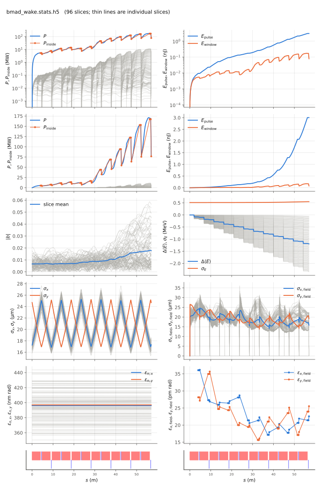

<!-- Generated by report_examples.py from examples/bmad_wake/. Do not edit. -->



Everything on this page lives in and runs from `examples/bmad_wake/`.

:::{table} The case of this example: its lattice and its beam, from the statistics file of each of its runs. The emittance, the beam size and the Twiss functions are those of the slices at the first record, averaged over the slices by their current. They are moments of the macroparticles that were loaded, and so differ from the values of the input file by the statistics of the load.
:label: tab-case-bmad-wake

| quantity | `lucifer.toml` | `lucifer_transcribed.toml` |
|---|---|---|
| lattice file | `examples/bmad_wake/wake_lattice.bmad` | `examples/aramis.bmad` |
| radiation wavelength | 0.100 nm | 0.100 nm |
| beam energy | 5.80 GeV | 5.80 GeV |
| current | 3.00 kA, uniform along the window | 3.00 kA, uniform along the window |
| charge in the window | 288 fC | 288 fC |
| normalized emittance, x and y | 0.398 and 0.399 µm | 0.398 and 0.399 µm |
| rms relative momentum spread of a slice | $8.8\times10^{-5}$ | $8.8\times10^{-5}$ |
| rms beam size at the entrance, x and y | 17.3 and 24.7 µm | 17.3 and 24.7 µm |
| beta function at the entrance, x and y | 8.51 and 17.4 m | 8.51 and 17.4 m |
| alpha function at the entrance, x and y | $-0.69$ and $1.41$ | $-0.69$ and $1.41$ |
| undulator | helical, period 15.0 mm, rms parameter $a_w$ = 0.8485 | helical, period 15.0 mm, rms parameter $a_w$ = 0.8485 |
| undulator segments | 12 of 3.99 m | 12 of 3.99 m |
| quadrupoles | 12, $k_1$ from $-2$ to $2$ m$^{-2}$ | 12, $k_1$ from $-2$ to $2$ m$^{-2}$ |
| length of the line | 57.0 m | 57.0 m |
| window | 96 slices of 3 wavelengths | 96 slices of 3 wavelengths |
| FEL parameter $\rho$ of the one-dimensional theory | $5.1\times10^{-4}$ | $5.1\times10^{-4}$ |
| gain length of the one-dimensional theory | 1.34 m | 1.34 m |
:::

The example runs in two commands, with Bmad only:

    ../../build-release/bin/lucifer lucifer.toml
    ../../build-release/bin/lucifer lucifer_transcribed.toml
    python -m lucifer.plot bmad_wake.stats.h5

This is the resistive-wall wake of `../sase_wake`, delivered through Bmad's own wake machinery instead of the transcribed Genesis 1.3 Version 4 (Genesis4) model. `ztable.wake` is the Bane and Stupakov resistive-wall kernel for a 0.5 mm copper chamber, attached as an `sr_wake` `z_long` table to every element of `wake_lattice.bmad`. The undulators apply it once per element at mid-element across the whole window. The quadrupoles and pipes apply it through Bmad's own `track1_bunch`. The drift slots are pipes here, because a Bmad drift cannot carry a wake.

The line is the Aramis line of [`../aramis.bmad`](examples.md#ex-the-aramis-line), which `wake_lattice.bmad` calls, the lattice of the Benchmark1-SASE case of Genesis4: twelve helical undulator segments of 3.99 m with a period of 15 mm in a FODO channel of 57 m, resonant at 0.1 nm. The beam has an energy of 5.80 GeV, normalized emittances of 0.4 µm and an rms relative energy spread of 8.8e-5, with a uniform current of 3.0 kA over a window of 96 slices of 3 wavelengths.

The table was exported by `wake.write_kernels` and then converted to Bmad's conventions. The sign is flipped to Bmad's positive-decelerating sense, the self-slice term is unhalved, the causal side is at z < 0, and the table is padded past the window. The conversion is described in the header of `wake_lattice.bmad`, and any `wake.on` run regenerates the exported kernel (the manual's [Bmad element wakes section](../../fel-physics.md)).

`lucifer_transcribed.toml` is the comparison partner: the same beam and the same window through the transcribed model with the same chamber, so the two runs differ in the implementation and in nothing else. `../sase_wake` is not the partner, because it adds the gap and roughness terms that this table has no counterpart for.

The transcribed `chamber_wake` applies the wake per integration step, and the Bmad `sr_wake` `z_long` table applies it once per element. The exit mean energy change of each input file is in the table below on the example's page, and the two differ by well under a percent. Per slice, leaving out the 16 slices at the window head where the transcribed model lacks half a slice of charge ahead, the two agree to 0.74% on average and 1.92% at worst. The two implementations apply one physical wake at two granularities, and the granularity is what separates them.

The run reports the split between the mode and the wide-angle emission of the point beamlets. That emission comes from macroparticles that occupy one grid point each, and no real beam radiates it ([SASE convergence](../../startup-noise.md)). At the exit the power outside the split angle is a few percent of the power inside it in both runs, so the exit powers are the mode. With the filter off both input files reported far more power, nearly all of it that emission. The comparison between the two wake implementations is made on the beam's energy loss, which the split does not touch.

Each run takes about half a minute.

## Measured on this run

The runner wrote these from each run's stats file and log, and the keystone regenerates them. A float carries five significant digits.

| Quantity | `lucifer.toml` | `lucifer_transcribed.toml` | Unit |
|---|---|---|---|
| exit power | 7.7905e+07 | 7.9136e+07 | W |
| exit power per slice | 8.1151e+05 | 8.2433e+05 | W |
| exit power, rms over mean across slices | 1.8530e+00 | 1.8521e+00 |  |
| exit window energy | 7.7959e-11 | 7.9191e-11 | J |
| exit pulse energy, the window's and the light slipped out of it | 3.0055e-09 | 3.0490e-09 | J |
| peak power | 1.7127e+08 | 1.7371e+08 | W |
| s of the peak power | 5.5881e+01 | 5.5881e+01 | m |
| mode peak, power inside the split | 1.6727e+08 | 1.7002e+08 | W |
| s of the mode peak | 5.6240e+01 | 5.6240e+01 | m |
| exit power inside the split | 7.6657e+07 | 7.7866e+07 | W |
| exit power outside the split | 1.2484e+06 | 1.2702e+06 | W |
| outside over inside, the run's maximum | 1.3397e-02 | 1.3443e-02 |  |
| outside over inside at the exit | 1.6285e-02 | 1.6313e-02 |  |
| split angle | 2.9826e-06 | 2.9826e-06 | rad |
| gain length, the shortest e-folding length over five consecutive records | 3.8515e+00 | 3.8355e+00 | m |
| power at the first element end | 5.4714e+06 | 5.4710e+06 | W |
| power per slice at the first element end | 5.6994e+04 | 5.6990e+04 | W |
| initial bunching, mean |b| over slices | 6.6356e-03 | 6.6356e-03 |  |
| exit bunching, mean |b| over slices | 1.7787e-02 | 1.7912e-02 |  |
| exit bunching, the largest slice | 5.6521e-02 | 5.7165e-02 |  |
| bunching, the maximum along the line of the mean |b| | 1.8033e-02 | 1.8140e-02 |  |
| s of the bunching maximum | 5.6240e+01 | 5.6240e+01 | m |
| bunching at the mode peak | 1.8039e-02 | 1.8145e-02 |  |
| power of the largest slice at the bunching maximum | 1.1559e+07 | 1.1771e+07 | W |
| exit power of the largest slice | 6.6001e+06 | 6.6966e+06 | W |
| mean slice energy at the start | 5.8038e+09 | 5.8038e+09 | eV |
| mean slice energy at the exit | 5.8026e+09 | 5.8026e+09 | eV |
| mean slice energy, exit minus start | -1.1955e+06 | -1.1875e+06 | eV |
| slice energy spread at the start | 5.1039e+05 | 5.1039e+05 | eV |
| slice energy spread at the exit | 5.4786e+05 | 5.4582e+05 | eV |
| span of the slice energies at the exit, head to tail | 2.2941e+06 | 2.3008e+06 | eV |
| slices | 96 | 96 |  |
| records | 1105 | 1105 |  |
| slice spacing | 3.0000e-10 | 3.0000e-10 | m |
| macroparticles per slice | 2048 | 2048 |  |
| grid points | 256 | 256 |  |
| grid cell | 1.5686e-06 | 1.5686e-06 | m |
| grid derived by setup | no | no |  |
| FEL steps | 1068 | 1068 |  |
| source filter, mode angle | 2.9826e-06 | 2.9826e-06 | rad |
| source filter, rho angle | 2.6261e-06 | 2.6261e-06 | rad |
| source filter, ratio of the angles | 1.1358e+00 | 1.1358e+00 |  |
| source filter, edge | 2.9826e-06 | 2.9826e-06 | rad |
| beamlet size | 4 | 4 |  |
| beamlet size derived by setup | yes | yes |  |
| macroparticles per slice derived by setup | no | no |  |

## The input files

The input file, its variants, and any lattice they name, as they are on disk.

### `lucifer.toml`

```toml
lattice = "wake_lattice.bmad"

[run]
out_root = "bmad_wake"
ran_seed = 12345

[window]
window_length = 2.88e-8
n_wavelength = 3

[beam]
n_particle = 2048
bunch_charge = 2.881993782512e-13
sig_pz = 8.804506566858e-5
a_norm_emit = 4e-7
b_norm_emit = 4e-7
z_distribution = "GRID"
z_min = -1.44e-8
z_max = 1.44e-8
shot_noise = true

[field]
lambda0 = 1e-10
grid_n_pts = 256
grid_half_width = 2e-4
seed_power = 0
```

### `lucifer_transcribed.toml`

```toml
lattice = "../aramis.bmad"

[run]
out_root = "transcribed"
ran_seed = 12345

[window]
window_length = 2.88e-8
n_wavelength = 3

[beam]
n_particle = 2048
bunch_charge = 2.881993782512e-13
sig_pz = 8.804506566858e-5
a_norm_emit = 4e-7
b_norm_emit = 4e-7
z_distribution = "GRID"
z_min = -1.44e-8
z_max = 1.44e-8
shot_noise = true

[field]
lambda0 = 1e-10
grid_n_pts = 256
grid_half_width = 2e-4
seed_power = 0

[wake]
on = true
radius = 0.5e-3
material = "CU"
```

### `wake_lattice.bmad`

```fortran
! The Benchmark1-SASE line with a resistive-wall chamber wake on every element, delivered
! through Bmad's own machinery. ztable.wake is the Bane and Stupakov kernel for a
! 0.5 mm copper chamber (AC conductivity 5.813e7 S/m, relaxation 8.1 um), exported by
! wake.write_kernels and then converted: sign flipped to Bmad's
! positive-decelerating convention, self-slice unhalved, causal side z < 0, padded past
! the window with zeros. Any run with wake.on regenerates the exported kernel.
!
! The undulators apply it through the FEL walk, one whole-window kick at mid-element,
! and the quads and pipes through Bmad's own track1_bunch. The drift slots are pipes,
! tracked identically, because a Bmad drift cannot carry a wake.
call, file = ../aramis.bmad
UND[sr_wake] = {scale_with_length = T, z_long = {position_dependence = none, w = { call::ztable.wake }}}
QF[sr_wake]  = {scale_with_length = T, z_long = {position_dependence = none, w = { call::ztable.wake }}}
QD[sr_wake]  = {scale_with_length = T, z_long = {position_dependence = none, w = { call::ztable.wake }}}
P1: pipe, l = 0.44, sr_wake = {scale_with_length = T, z_long = {position_dependence = none, w = { call::ztable.wake }}}
P2: pipe, l = 0.24, sr_wake = {scale_with_length = T, z_long = {position_dependence = none, w = { call::ztable.wake }}}
FODOW: line = (UND, P1, QF, P2, UND, P1, QD, P2)
ARAMISW: line = (6*FODOW)
use, ARAMISW
```
