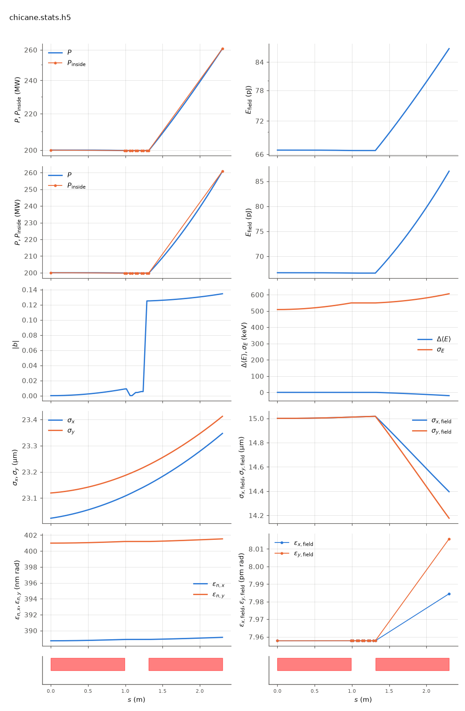

<!-- Generated by report_examples.py from examples/chicane/. Do not edit. -->



Everything on this page lives in and runs from `examples/chicane/`.

The example runs in two commands, with Bmad only:

    ../../build-release/bin/lucifer lucifer.toml
    ../../build-release/bin/lucifer lucifer_detuned.in

The line is two undulator segments with a four-bend closed-bump chicane in the break, in absolute time tracking mode (`bmad_com[absolute_time_tracking] = T` in the lattice). The inter-segment phase then follows the real geometry. The beam detours the bump while the radiation drifts the chord between the undulator faces, which is computed from `ele%floor` and never entered by hand. The arc-minus-chord delay (583 wavelengths at the reference angle) re-injects the light onto the bunched beam at whatever carrier phase the bend angle dictates.

The two lattices differ by 0.43 microradians of bend angle: half a wavelength of delay. With a 200 MW seed and two 0.99 m helical segments, the two lattices leave the first segment with the same power and part in the second. `chicane.bmad`, in phase, amplifies in the second segment. `detuned.bmad`, with half a wavelength more delay, absorbs there, and its exit power ends below the seed. The power after the first segment and the exit power of each deck are in the table below on the example's page.

The second segment amplifies or absorbs on a half-wavelength of geometry. A real machine turns that knob by trimming its chicane. In the default relative mode the same two lattices produce identical output, since the geometric fraction is autophased away, which is the chicane semantics of Genesis 1.3 Version 4 (Genesis4). The deliberate off-phase knob in that mode is the wiggler's own `z_offset` (the manual's phasing section).

The benchmark's phasing section checks the same physics. The re-anchor baseline is flat, and the z_offset knob sits on the analytic slope. The knob curve equals Genesis4's own PHASESHIFTER scan. The absolute-mode chicane ramp sits on the independent geometric prediction, and the unaveraged ledger closes across the chicane. The levels are in [](../../validation.md#val-levels-phasing). Four refusals are asserted.

Each run takes about a second.

## Measured on this run

The runner wrote these from each run's stats file and log, and the keystone regenerates them. A float carries five significant digits.

| Quantity | `lucifer.toml` | `lucifer_detuned.toml` | Unit |
|---|---|---|---|
| exit power | 2.6084e+08 | 1.8402e+08 | W |
| exit power per slice | 2.6084e+08 | 1.8402e+08 | W |
| exit pulse energy | 8.7007e-11 | 6.1382e-11 | J |
| peak power | 2.6084e+08 | 2.0000e+08 | W |
| s of the peak power | 2.3050e+00 | 2.1000e-01 | m |
| mode peak, power inside the split | 2.6081e+08 | 2.0000e+08 | W |
| s of the mode peak | 2.3050e+00 | 0.0000e+00 | m |
| exit power inside the split | 2.6081e+08 | 1.8400e+08 | W |
| exit power outside the split | 2.6656e+04 | 1.9107e+04 | W |
| outside over inside, the run's maximum | 1.0220e-04 | 1.5550e-06 |  |
| outside over inside at the exit | 1.0220e-04 | 1.0384e-04 |  |
| split angle | 2.7594e-06 | 2.7594e-06 | rad |
| power at the first element end | 1.9978e+08 | 1.9978e+08 | W |
| power per slice at the first element end | 1.9978e+08 | 1.9978e+08 | W |
| initial bunching, mean |b| over slices | 3.9886e-17 | 3.9886e-17 |  |
| exit bunching, mean |b| over slices | 1.3452e-01 | 1.1840e-01 |  |
| exit bunching, the largest slice | 1.3452e-01 | 1.1840e-01 |  |
| bunching, the maximum along the line of the mean |b| | 1.3452e-01 | 1.2541e-01 |  |
| s of the bunching maximum | 2.3050e+00 | 1.4800e+00 | m |
| bunching at the mode peak | 1.3452e-01 | 3.9886e-17 |  |
| power of the largest slice at the bunching maximum | 2.6084e+08 | 1.9284e+08 | W |
| exit power of the largest slice | 2.6084e+08 | 1.8402e+08 | W |
| mean slice energy at the start | 5.8038e+09 | 5.8038e+09 | eV |
| mean slice energy at the exit | 5.8038e+09 | 5.8038e+09 | eV |
| mean slice energy, exit minus start | -2.0246e+04 | 5.4705e+03 | eV |
| slice energy spread at the start | 5.0879e+05 | 5.0879e+05 | eV |
| slice energy spread at the exit | 6.0581e+05 | 5.6553e+05 | eV |
| span of the slice energies at the exit, head to tail | 0.0000e+00 | 0.0000e+00 | eV |
| slices | 1 | 1 |  |
| records | 142 | 142 |  |
| slice spacing | 1.0000e-10 | 1.0000e-10 | m |
| macroparticles per slice | 8192 | 8192 |  |
| grid points | 128 | 128 |  |
| grid cell | 3.1500e-06 | 3.1500e-06 | m |
| grid derived by setup | no | no |  |
| FEL steps | 132 | 132 |  |
| source filter, mode angle | 2.7590e-06 | 2.7590e-06 | rad |
| source filter, rho angle | 2.5490e-06 | 2.5490e-06 | rad |
| source filter, ratio of the angles | 1.0800e+00 | 1.0800e+00 |  |
| source filter, edge | 2.7594e-06 | 2.7594e-06 | rad |

## The input files

The deck, its variants, and any lattice they name, as they are on disk.

### `lucifer.toml`

```toml
lattice = "chicane.bmad"

[run]
out_root = "chicane"
ran_seed = 12345

[beam]
n_particle = 8192
bunch_charge = 1.000692285594e-15
sig_z = 0
sig_pz = 8.804506566858e-5
a_norm_emit = 4e-7
b_norm_emit = 4e-7

[field]
lambda0 = 1e-10
grid_n_pts = 128
grid_half_width = 2e-4
seed_power = 2e8
seed_waist_size = 30e-6
```

### `lucifer_detuned.toml`

```toml
lattice = "detuned.bmad"

[run]
out_root = "detuned"
ran_seed = 12345

[beam]
n_particle = 8192
bunch_charge = 1.000692285594e-15
sig_z = 0
sig_pz = 8.804506566858e-5
a_norm_emit = 4e-7
b_norm_emit = 4e-7

[field]
lambda0 = 1e-10
grid_n_pts = 128
grid_half_width = 2e-4
seed_power = 2e8
seed_waist_size = 30e-6
```

### `chicane.bmad`

```fortran
ANG = 1e-3                     ! The reference bend angle.
call, file = chicane_base.bmad
```

### `chicane_base.bmad`

```fortran
! Chicane-between-segments example line (the manual's phasing section): two undulator segments
! with a four-bend closed-bump chicane in the break. Absolute time tracking is on, so
! the inter-segment phase follows the real geometry: the beam detours the bump while
! the radiation drifts the chord, and the arc-minus-chord delay -- thousands of
! wavelengths -- re-injects the light onto the bunched beam at whatever carrier phase
! the bend angle dictates. The wrappers define ANG before calling this file: two
! angles a half-wavelength of delay apart flip the second segment between absorbing
! and amplifying.

no_digested
parameter[geometry] = open
parameter[particle] = electron
parameter[e_tot] = 11357.82 * m_electron

beginning[beta_a] = 15
beginning[beta_b] = 15

bmad_com[absolute_time_tracking] = T

UND: wiggler, l = 0.99, l_period = 0.015, field_calc = helical_model, &
     b_max = 0.84853 * (twopi / 0.015) * m_electron / c_light, &
     fel_method = averaged, ds_step = 0.015

B1: sbend, l = 0.05, g =  ANG / 0.05
B2: sbend, l = 0.05, g = -ANG / 0.05
B3: sbend, l = 0.05, g = -ANG / 0.05
B4: sbend, l = 0.05, g =  ANG / 0.05
DD: pipe, l = 0.025

SEG: line = (UND, DD, B1, DD, B2, DD, B3, DD, B4, DD, UND)

use, SEG
```

### `detuned.bmad`

```fortran
ANG = 1e-3 + 4.29e-7           ! Half a wavelength more delay than chicane.bmad.
call, file = chicane_base.bmad
```
