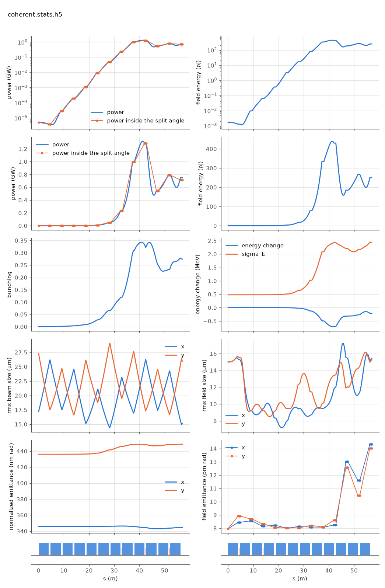

<!-- Generated by report_examples.py from examples/coherent_source/. Do not edit. -->



Everything on this page lives in and runs from `examples/coherent_source/`.

The example runs in three commands, with Bmad only:

    ../../build-release/bin/lucifer lucifer.toml
    ../../build-release/bin/lucifer lucifer_low_m.in
    ../../build-release/bin/lucifer lucifer_reference.in
    python -m lucifer.plot coherent.stats.h5

A run whose beam is transversely Gaussian (an idealized machine, a parameter scan, a seeded amplifier study) can trade the per-particle source deposit for Tanaka's coherent retrieval, `run.source_model = "coherent"` (PRAB 27, 030703 (2024), the manual's coherent-source section). It then converges at one to two orders of magnitude fewer macroparticles. With few particles the per-cell source is spiky, and that sampling noise always overestimates the gain. The coherent source carries the slice's exact bunching phasor on a fitted Gaussian instead, so the artifact never enters.

Three runs of the same seeded steady-state case (the full Aramis line, 5.2 decades of gain, ../steady_state's configuration) are compared. `lucifer_reference.in` deposits 8192 particles per slice. `lucifer_low_m.in` deposits 512. `lucifer.toml` runs the coherent source on the same 512. The measured quantities are in the table below. The low-M deposit comes out high against the reference, and the coherent source at the same count lands close to it. Each run takes a few seconds.

The low-M deposit is the artifact the coherent source removes, and the source filter, on by default, removes most of it on its own. Cutting particles without the coherent source raises the predicted power on this case, and with the filter off the rise was far larger. The run's own convergence report gives the power outside the split angle over the power inside it, and the table carries that ratio at the exit for each run. The coherent source builds no transformed source for the filter to act on, so the filter turns itself off for that run and says so. Its own ratio at the exit is the largest of the three ([the convergence section](../../fel-physics.md#sec-convergence)). The power the low-M deposit adds is the wide-angle emission of 64 beamlets. The coherent source does not have it, since it never puts a macroparticle on a grid point. `lucifer.toml` is the same particle count giving the converged answer. Per-slice cost dominates a time-dependent run, where the same particle reduction pays in proportion.

The refusals are part of the feature (the manual's coherent-source section). A per-slice Gaussianity test is sized against its own sampling significance, and a profile with real structure is refused. An offset, mismatched or tilted Gaussian beam passes, since the source centers and tilts with the beam's phasor-weighted moments. Harmonic fields, two live polarizations and the unaveraged mode are refused in v1. A dark start is refused, since the coherent model drops the spontaneous, spatially incoherent emission that SASE grows from, and its startup comes out far too low. Seed the field, as here, or use the default deposit.

Plot any run with python -m lucifer.plot <root>.stats.h5.

## Measured on this run

The runner wrote these from each run's stats file and log, and the keystone regenerates them. A float carries five significant digits.

| Quantity | `lucifer.toml` | `lucifer_low_m.toml` | `lucifer_reference.toml` | Unit |
|---|---|---|---|---|
| exit power | 7.4861e+08 | 1.1816e+09 | 8.0199e+08 | W |
| exit power per slice | 7.4861e+08 | 1.1816e+09 | 8.0199e+08 | W |
| exit pulse energy | 2.4971e-10 | 3.9412e-10 | 2.6752e-10 | J |
| peak power | 1.3182e+09 | 1.6683e+09 | 1.5611e+09 | W |
| s of the peak power | 4.1318e+01 | 3.8762e+01 | 3.8134e+01 | m |
| mode peak, power inside the split | 1.2854e+09 | 1.5881e+09 | 1.5578e+09 | W |
| s of the mode peak | 4.1990e+01 | 3.8000e+01 | 3.7760e+01 | m |
| exit power inside the split | 7.1333e+08 | 1.1569e+09 | 7.9951e+08 | W |
| exit power outside the split | 3.5283e+07 | 2.4610e+07 | 2.4843e+06 | W |
| outside over inside, the run's maximum | 3.3331e-03 | 1.0852e-02 | 1.3742e-03 |  |
| outside over inside at the exit | 4.9463e-02 | 2.1272e-02 | 3.1073e-03 |  |
| split angle | 2.7931e-06 | 2.7931e-06 | 2.9661e-06 | rad |
| gain length, the shortest e-folding length over five consecutive records | 2.0369e+00 | 1.9904e+00 | 2.1043e+00 | m |
| power at the first element end | 3.8806e+03 | 4.1976e+03 | 4.1639e+03 | W |
| power per slice at the first element end | 3.8806e+03 | 4.1976e+03 | 4.1639e+03 | W |
| initial bunching, mean |b| over slices | 3.8856e-17 | 3.8856e-17 | 3.9886e-17 |  |
| exit bunching, mean |b| over slices | 2.7442e-01 | 1.7420e-01 | 2.4127e-01 |  |
| exit bunching, the largest slice | 2.7442e-01 | 1.7420e-01 | 2.4127e-01 |  |
| bunching, the maximum along the line of the mean |b| | 3.4271e-01 | 2.3820e-01 | 3.0279e-01 |  |
| s of the bunching maximum | 4.0780e+01 | 3.7240e+01 | 3.8403e+01 | m |
| bunching at the mode peak | 3.3428e-01 | 2.3442e-01 | 3.0195e-01 |  |
| power of the largest slice at the bunching maximum | 1.3026e+09 | 1.6053e+09 | 1.5550e+09 | W |
| exit power of the largest slice | 7.4861e+08 | 1.1816e+09 | 8.0199e+08 | W |
| mean slice energy at the start | 5.8038e+09 | 5.8038e+09 | 5.8038e+09 | eV |
| mean slice energy at the exit | 5.8036e+09 | 5.8034e+09 | 5.8036e+09 | eV |
| mean slice energy, exit minus start | -2.1383e+05 | -4.2874e+05 | -2.6909e+05 | eV |
| slice energy spread at the start | 4.7654e+05 | 4.7654e+05 | 5.0879e+05 | eV |
| slice energy spread at the exit | 2.4428e+06 | 2.7134e+06 | 2.5464e+06 | eV |
| span of the slice energies at the exit, head to tail | 0.0000e+00 | 0.0000e+00 | 0.0000e+00 | eV |
| slices | 1 | 1 | 1 |  |
| records | 1105 | 1105 | 1105 |  |
| slice spacing | 1.0000e-10 | 1.0000e-10 | 1.0000e-10 | m |
| macroparticles per slice | 512 | 512 | 8192 |  |
| grid points | 256 | 256 | 256 |  |
| grid cell | 1.5690e-06 | 1.5690e-06 | 1.5690e-06 | m |
| grid derived by setup | no | no | no |  |
| FEL steps | 1068 | 1068 | 1068 |  |
| source filter, mode angle |  | 2.7930e-06 | 2.9660e-06 | rad |
| source filter, rho angle |  | 2.5600e-06 | 2.6110e-06 | rad |
| source filter, ratio of the angles |  | 1.0900e+00 | 1.1400e+00 |  |
| source filter, edge |  | 2.7931e-06 | 2.9661e-06 | rad |

## The input files

The input file, its variants, and any lattice they name, as they are on disk.

### `lucifer.toml`

```toml
lattice = "../aramis.bmad"

[run]
out_root = "coherent"
source_model = "coherent"

[beam]
n_particle = 512
bunch_charge = 1.000692285594e-15
sig_z = 0
sig_pz = 8.804506566858e-5
a_norm_emit = 4e-7
b_norm_emit = 4e-7

[field]
lambda0 = 1e-10
grid_n_pts = 256
grid_half_width = 2e-4
seed_power = 5e3
seed_waist_size = 30e-6
```

### `lucifer_low_m.toml`

```toml
lattice = "../aramis.bmad"

[run]
out_root = "low_m"

[beam]
n_particle = 512
bunch_charge = 1.000692285594e-15
sig_z = 0
sig_pz = 8.804506566858e-5
a_norm_emit = 4e-7
b_norm_emit = 4e-7

[field]
lambda0 = 1e-10
grid_n_pts = 256
grid_half_width = 2e-4
seed_power = 5e3
seed_waist_size = 30e-6
```

### `lucifer_reference.toml`

```toml
lattice = "../aramis.bmad"

[run]
out_root = "reference"

[beam]
n_particle = 8192
bunch_charge = 1.000692285594e-15
sig_z = 0
sig_pz = 8.804506566858e-5
a_norm_emit = 4e-7
b_norm_emit = 4e-7

[field]
lambda0 = 1e-10
grid_n_pts = 256
grid_half_width = 2e-4
seed_power = 5e3
seed_waist_size = 30e-6
```
