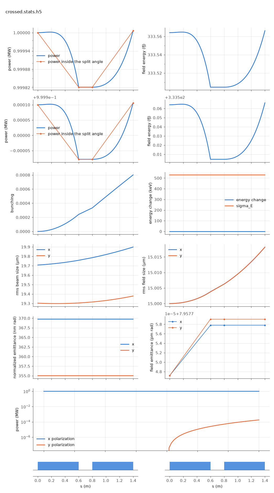

<!-- Generated by report_examples.py from examples/crossed_undulator/. Do not edit. -->



Everything on this page lives in and runs from `examples/crossed_undulator/`.

An x-planar undulator (0.6 m) seeds and microbunches the beam. The same undulator rotated a quarter turn, `UNDY: UNDX, tilt = pi/2`, follows after a short gap. The tilt is standard Bmad, and it is what states the polarization. Microbunching is longitudinal and blind to polarization, so the y set radiates orthogonally polarized light seeded by the bunching the x set built. The x field passes through the y set gaining nothing, and the validation suite holds that isolation at the level in [](../../validation.md#val-levels-two-polarization) (the manual's field-solver vector convention).

    ../../build-release/bin/lucifer lucifer.toml
    python -m lucifer.plot crossed.stats.h5

With a 1 MW x seed, a 0.6 m x-set, a 0.2 m gap and a 0.6 m y-set, P_x is flat through the y-set to five digits, while P_y climbs from nothing on the microbunching the x-set left behind. The measured quantities are in the table below, the total exit power and the power inside the split angle among them, and the plot carries P_y along z. The tilted undulator cannot amplify the orthogonal component. It only diffracts it. The summary figure shows this in its polarization panel, which is present only when a run carries two components, and that figure is this example's page in the documentation.

The outputs are `crossed-final.wf.h5`, an openPMD EXT_Wavefront file carrying both polarizations as the x and y components of one mesh record, and `crossed.stats.h5`, whose field group carries the total, the x component and a `field/y/` group. The run takes about a second.

## Measured on this run

The runner wrote these from each run's stats file and log, and the keystone regenerates them. A float carries five significant digits.

| Quantity | `lucifer.toml` | Unit |
|---|---|---|
| exit power | 1.0000e+06 | W |
| exit power per slice | 1.0000e+06 | W |
| exit window energy | 3.3357e-13 | J |
| exit pulse energy, the window's and the light slipped out of it | 3.3357e-13 | J |
| peak power | 1.0000e+06 | W |
| s of the peak power | 1.4000e+00 | m |
| mode peak, power inside the split | 1.0000e+06 | W |
| s of the mode peak | 1.4000e+00 | m |
| exit power inside the split | 1.0000e+06 | W |
| exit power outside the split | 3.5795e-01 | W |
| outside over inside, the run's maximum | 3.5795e-07 |  |
| outside over inside at the exit | 3.5795e-07 |  |
| split angle | 3.2637e-06 | rad |
| power at the first element end | 9.9982e+05 | W |
| power per slice at the first element end | 9.9982e+05 | W |
| initial bunching, mean |b| over slices | 4.2511e-17 |  |
| exit bunching, mean |b| over slices | 8.0057e-04 |  |
| exit bunching, the largest slice | 8.0057e-04 |  |
| bunching, the maximum along the line of the mean |b| | 8.0057e-04 |  |
| s of the bunching maximum | 1.4000e+00 | m |
| bunching at the mode peak | 8.0057e-04 |  |
| power of the largest slice at the bunching maximum | 1.0000e+06 | W |
| exit power of the largest slice | 1.0000e+06 | W |
| mean slice energy at the start | 5.8038e+09 | eV |
| mean slice energy at the exit | 5.8038e+09 | eV |
| mean slice energy, exit minus start | -3.9091e-03 | eV |
| slice energy spread at the start | 5.2937e+05 | eV |
| slice energy spread at the exit | 5.2944e+05 | eV |
| span of the slice energies at the exit, head to tail | 0.0000e+00 | eV |
| slices | 1 |  |
| records | 82 |  |
| slice spacing | 1.0000e-10 | m |
| macroparticles per slice | 2048 |  |
| grid points | 128 |  |
| grid cell | 3.1500e-06 | m |
| grid derived by setup | no |  |
| FEL steps | 80 |  |
| source filter, mode angle | 3.2640e-06 | rad |
| source filter, rho angle | 2.5880e-06 | rad |
| source filter, ratio of the angles | 1.2600e+00 |  |
| source filter, edge | 3.2637e-06 | rad |
| exit power, the y component | 1.8501e+02 | W |

## The input files

The input file, its variants, and any lattice they name, as they are on disk.

### `lucifer.toml`

```toml
lattice = "run_lattice.bmad"

[run]
out_root = "crossed"
ran_seed = 4242

[beam]
n_particle = 2048
bunch_charge = 1.000692285594e-15
sig_z = 0
sig_pz = 8.804506566858e-05
a_norm_emit = 4e-7
b_norm_emit = 4e-7
beamlet_size = 8

[field]
lambda0 = 1e-10
grid_n_pts = 128
grid_half_width = 2e-4
seed_power = 1e6
seed_waist_size = 30e-6
```

### `crossed.bmad`

```fortran
! Two-polarization probes (check_two_polarization.py). A symmetric configuration --
! round beam Twiss, no quads -- so the rotation-identity check (an all-y line must
! reproduce the all-x line under the x<->y swap) is not broken by the lattice.
!
! UNDX: planar, wiggles in x. UNDY: the same undulator physically rotated a quarter
! turn (tilt = pi/2), wiggling in y. Lines:
!   XLINE:   two x-planar segments                (the reference)
!   YLINE:   the same two segments, both tilted   (the rotation image)
!   CROSSED: x-segment then y-segment             (the crossed-undulator case)

no_digested
parameter[geometry] = open
parameter[particle] = electron
parameter[e_tot] = 11357.82 * m_electron

beginning[beta_a] = 12.0
beginning[alpha_a] = 0
beginning[beta_b] = 12.0
beginning[alpha_b] = 0

UNDX: wiggler, l = 0.60, l_period = 0.015, field_calc = planar_model, &
      b_max = 0.84853 * sqrt(2) * (twopi / 0.015) * m_electron / c_light, &
      fel_method = averaged, ds_step = 0.015

UNDY: UNDX, tilt = pi / 2

D1: pipe, l = 0.20

XLINE:   line = (UNDX, D1, UNDX)
YLINE:   line = (UNDY, D1, UNDY)
CROSSED: line = (UNDX, D1, UNDY)

use, XLINE
```

### `run_lattice.bmad`

```fortran
call, file = crossed.bmad
use, CROSSED
```
