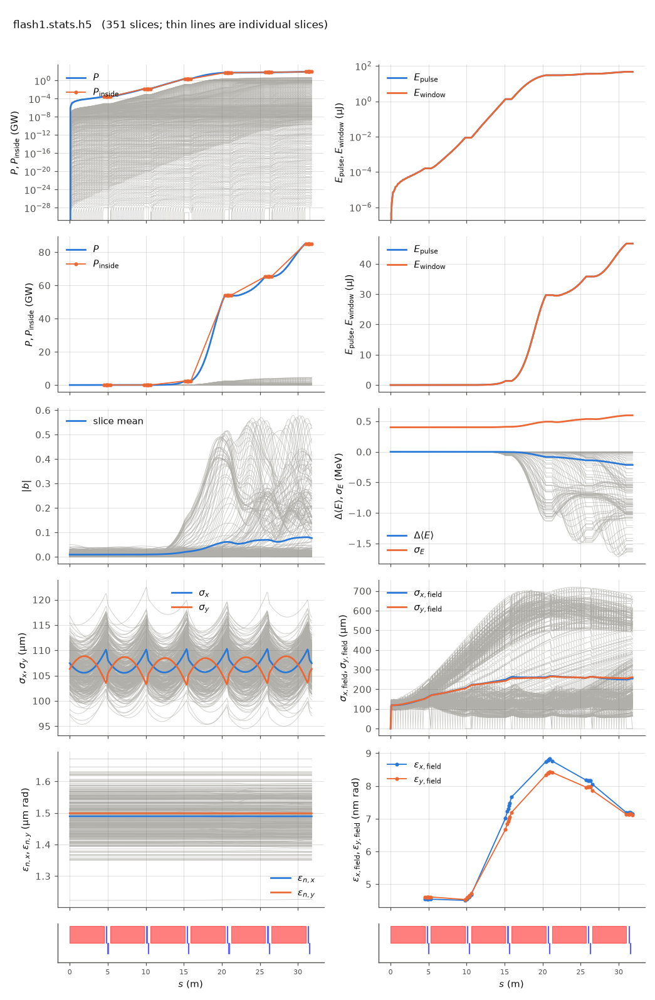

<!-- Generated by report_examples.py from examples/flash1/. Do not edit. -->



Everything on this page lives in and runs from `examples/flash1/`.

The example runs in one command, with Bmad only:

    ../../build-release/bin/lucifer lucifer.toml
    python -m lucifer.plot flash1.stats.h5

FLASH at DESY lased at 13.7 nm in 2006, the first free-electron laser to reach saturation at that wavelength, and reported its undulator, its beam and its performance. This example is that line: six planar segments, a Gaussian bunch on the published beam, and SASE from the quiet start through 27 m of undulator. Every other example in this directory runs the Aramis benchmark at 0.1 nm, so this one is also the third machine the numerical defaults are measured on ([SASE convergence](../../startup-noise.md)).

The first source is Ackermann et al., *Operation of a free-electron laser from the extreme ultraviolet to the water window*, Nature Photonics **1**, 336 (2007), [doi:10.1038/nphoton.2007.76](https://doi.org/10.1038/nphoton.2007.76). The second is Schreiber and Faatz, *The free-electron laser FLASH*, High Power Laser Science and Engineering **3**, e20 (2015), [doi:10.1017/hpl.2015.16](https://doi.org/10.1017/hpl.2015.16).

## What is published and what this file chose

| quantity | published | source | this file | note |
|---|---|---|---|---|
| undulator period | 2.73 cm | Ackermann, results | 0.0273 m | |
| peak field | 0.47 T | Ackermann, results | `b_max = 0.47` | |
| undulator parameter | K = 1.23, K_rms = 0.9 | Schreiber 3.4 | K = 1.19807, aw = 0.847162 | derived from the field, 2.7 percent under the published K |
| gap | 12 mm fixed | both | not modelled | a Bmad wiggler is described by its field |
| segments | six, 4.5 m each | Ackermann, results | six, 4.5045 m | 165 whole periods, since 4.5 m is 164.84 of them |
| intersection | doublet, monitors, wire scanners | Schreiber 3.4 | 0.8 m, `QF` and `QD` at k1 = 1.3 and -0.8 | length and strengths chosen here |
| beta function | about 10 m | Schreiber 3.4 | 10.0 m mean, 9.3 to 10.6 m | what the chosen doublet gives |
| beam energy | 700 MeV, spike near 680 MeV | Ackermann, results and Fig. 2 | 668.494 MeV | the resonance at 13.7 nm for K = 1.19807 |
| peak current | 2 to 2.5 kA | Ackermann, saturated output | 2.5 kA | the upper end |
| spike length | about 30 fs FWHM | Ackermann, saturated output | `sig_z = 3.8193e-6` m | a Gaussian of that width, 79.8 pC |
| normalized emittance | 1 to 1.5 mm mrad | Ackermann, saturated output | 1.5 µm both planes | the upper end |
| energy spread | below 0.1 percent | Schreiber 2 | `sig_pz = 6e-4` | argued below |
| Pierce parameter | 2.5 to 3 x 10^-3 | Ackermann, saturated output | 1.97 x 10^-3 | this beam, with the planar coupling |

Three numbers are this file's and are marked in the lattice header. The segment is a whole number of periods because the FEL step wants one. The intersection has a length because a drift must, and the papers give none. The doublet has strengths because the beta function of 10 m has to come from somewhere. A planar undulator focuses vertically only, and its own focusing gives 6.71 m vertically and nothing horizontally, so the doublet makes the horizontal beta function and raises the vertical one.

The published K and the published field disagree by 2.7 percent. K = 1.23 needs 0.4825 T at this period. The field is the one taken. The disagreement then appears again in the energy: 13.7 nm needs 668.5 MeV at K = 1.19807 and 686 MeV at K = 1.23, against the machine's 700 MeV with its lasing spike near 680.

The slice energy spread is derived rather than published. The papers give a bound on the beam and no slice value. Figure 2 of Ackermann puts a chirp of about 0.1 MeV per fs across the lasing spike. The FEL averages over one coherence time, measured there as 4.2 fs, so the chirp contributes 0.42 MeV to the spread the interaction sees, which is 6e-4 of the energy. That is the value here, and it is under the published bound of 0.1 percent. The value matters, since the field gain length of this input file grows by more than half between a spread of 1e-4 and one of 1e-3.

## What the run measures

Four seeds were run at the settings below, measured with the source filter off. The spread is the SASE fluctuation of the window. The same four seeds were run with the filter on, as the input file runs, and one analysis was applied to both sets. The exit pulse energy and the peak bunching agree between the two sets within the seed spread, and the fitted field gain length is shorter by a few percent with the filter on. Those comparisons come from one fit over both sets, which is not the fit the rows below were recorded with, so they compare with each other and not with the table. The wide-angle emission raises the startup level the fit begins from, so a curve carrying it climbs more slowly through the fit window and reads longer. The exit power, pulse energy, bunching and split of the input file as it runs are in the table below.

| quantity | this input file | published | source |
|---|---|---|---|
| field gain length in the exponential regime | 2.05 +- 0.16 m | 2.5 +- 0.3 m | Ackermann Fig. 4a |
| end of the exponential regime | 20.9 +- 1.1 m | inside the 27 m line | Ackermann Fig. 4a |
| pulse energy there | 26.6 +- 5.7 µJ | 40 µJ characterized, 70 µJ demonstrated | Ackermann, results |
| peak power in one slice at the exit | 2.8 to 5.0 GW | 10 GW | Ackermann, abstract |

The gain lengths agree where their bands meet and the pulse energies agree. The simulation reaches the exponential regime sooner than the machine did, which is what an ideal beam does. This input file has no energy chirp along the bunch, no wakefield from the 12 mm gap, and no error in the trajectory or the matching, and each of those lengthens a real gain curve. The chirp is the largest of them. Ackermann reports a 10 fs radiation pulse out of a 30 fs spike, because the chirp takes the rest of the spike off resonance. This input file lases over the whole spike, so its pulse is longer than the machine's.

The gain length is read from the 4 m window of fastest growth in the pulse energy. Read instead over the whole rise from startup to saturation it is 2.9 m, since the curve is not one exponential. Ackermann fit the exponential part of Fig. 4a, which is the same choice.

## The numerical settings, and how each was chosen

Every value is measured on this machine. The Aramis column is what the other examples use at 0.1 nm on a beam five times smaller.

| setting | Aramis | here | measured |
|---|---|---|---|
| `grid_n_pts` | 255 | 129 | cells of sigma_x/6.8, the criterion of the convergence page. 65 points give a lower pulse energy, and 257 raise the share of the power outside the mode several times |
| `grid_half_width` | 2e-4 m | 1.0e-3 m | 9.3 rms beam sizes. At the same cell size 0.7 mm and 1.5 mm give pulse energies that agree to a tenth of a percent, so the half width does not enter |
| `ds_step` | 0.045 m | 0.0819 m | three periods, 55 steps per segment. One period gives a pulse energy inside the seed spread, at nearly three times the wall clock |
| `window.n_wavelength` | 3 | 12 | 3.4 slices per cooperation length of 40 wavelengths. Six wavelengths per slice give a pulse energy inside the seed spread, at twice the wall clock |
| `window.n_slice` | 96 | 351 | the bunch to four sigma either side, plus 990 wavelengths of slippage at each end |
| `beam.n_particle` | 2048 | 4096 | measured with the filter off, the share of the exit power outside the mode falls with the load, from a quarter at 1024 to under the convergence page's tenth at 4096 and lower again at 16384. The filter row below is what the load now rests on |
| `beamlet_size` | 8 | 8 | at 4096 particles, a beamlet of 4 leaves less outside the mode and one of 16 leaves more. Eight resolves three harmonics where four resolves one |
| `run.source_filter` | T | T | the default, at the derived edge the table below records. It removes most of the wide-angle power here and moves the pulse energy by under a percent, since 4096 particles has already converged. At 1024 particles it removes a larger share and reaches the same answer at two thirds of the wall clock |
| `beam.resample.slice_width` | 0.01 | not read | the input file describes its bunch and the loader evaluates it per slice, so nothing is resampled |

The rows were measured at 129 points here and 255 on Aramis. The input files state 128 and 256, the powers of two the device field solver takes.

Two of these do not carry over from Aramis. The convergence page estimates the wide-angle share in advance as 100/N_b times (1.57 µm/dx) squared, which gives 0.2 percent here, and the measurement with the filter off is far above it. The prefactor is the first machine's, as the page says, and it is 40 times low on this one, over cell sizes of 7.8 to 31 µm. The other is the cell size. The criterion sigma_x/7 holds, and it lands on 129 points at a 1 mm half width rather than 255 at 0.2 mm. An input file copied from `../sase` would therefore have run a grid 16 times too fine and reported a power that is mostly artifact.

## The beam and the window

The lattice carries the optics, so the bunch is generated matched to the periodic solution in the `beginning` statement, and there is no `gamma0` and no match transform. The current is derived from `bunch_charge` and `sig_z` and is never given. The window covers the bunch to four sigma either side with 990 wavelengths of slippage headroom at each end, because radiation made at the head of the bunch slips out of a shorter window before the exit. About a quarter of the slices therefore carry no charge, which is the price of holding the whole pulse.

On this input at the `ran_seed` default of 12345 the exit power summed over the window and the pulse energy are the table's. The run's own convergence report puts the power outside the split angle at well under a percent of the power inside it, so the total is the mode. With the filter off the same input file gave nearly the same power and pulse energy, with several percent of the total outside the mode. At this load the filter removes an artifact that was already small here, and the settings table above was measured without it.

Leaving `grid_n_pts` and `grid_half_width` out of the input file derives a grid whose cell is within a few percent of the stated one. That run gave the same pulse energy to a part in a thousand and the same ratio, so the stated grid is the derived one. The derivation rounds the point count up to a power of two, so the same input file without a grid derives the count the input file states.

The run takes about twenty seconds.

## Measured on this run

The runner wrote these from each run's stats file and log, and the keystone regenerates them. A float carries five significant digits.

| Quantity | `lucifer.toml` | Unit |
|---|---|---|
| exit power | 8.5177e+10 | W |
| exit power per slice | 2.4267e+08 | W |
| exit power, rms over mean across slices | 2.6601e+00 |  |
| exit window energy | 4.6709e-05 | J |
| exit pulse energy, the window's and the light slipped out of it | 4.6709e-05 | J |
| peak power | 8.5177e+10 | W |
| s of the peak power | 3.1577e+01 | m |
| mode peak, power inside the split | 8.5127e+10 | W |
| s of the mode peak | 3.1577e+01 | m |
| exit power inside the split | 8.5127e+10 | W |
| exit power outside the split | 5.0114e+07 | W |
| outside over inside, the run's maximum | 5.8869e-04 |  |
| outside over inside at the exit | 5.8869e-04 |  |
| split angle | 8.1501e-05 | rad |
| gain length, the shortest e-folding length over five consecutive records | 9.5236e-01 | m |
| power at the first element end | 2.8978e+05 | W |
| power per slice at the first element end | 8.2557e+02 | W |
| initial bunching, mean |b| over slices | 8.8848e-03 |  |
| exit bunching, mean |b| over slices | 7.6488e-02 |  |
| exit bunching, the largest slice | 5.3733e-01 |  |
| bunching, the maximum along the line of the mean |b| | 8.0278e-02 |  |
| s of the bunching maximum | 3.1027e+01 | m |
| bunching at the mode peak | 2.0050e-01 |  |
| power of the largest slice at the bunching maximum | 4.5362e+09 | W |
| exit power of the largest slice | 4.5362e+09 | W |
| mean slice energy at the start | 6.6849e+08 | eV |
| mean slice energy at the exit | 6.6828e+08 | eV |
| mean slice energy, exit minus start | -2.1442e+05 | eV |
| slice energy spread at the start | 4.0099e+05 | eV |
| slice energy spread at the exit | 5.9655e+05 | eV |
| span of the slice energies at the exit, head to tail | 1.6841e+06 | eV |
| slices | 351 |  |
| records | 361 |  |
| slice spacing | 1.6440e-07 | m |
| macroparticles per slice | 4096 |  |
| grid points | 128 |  |
| grid cell | 1.5748e-05 | m |
| grid derived by setup | no |  |
| FEL steps | 330 |  |
| source filter, mode angle | 8.1500e-05 | rad |
| source filter, rho angle | 4.4410e-05 | rad |
| source filter, ratio of the angles | 1.8400e+00 |  |
| source filter, edge | 8.1501e-05 | rad |

## The input files

The input file, its variants, and any lattice they name, as they are on disk.

### `lucifer.toml`

```toml
lattice = "flash1.bmad"

[run]
out_root = "flash1"

[window]
n_wavelength = 12
n_slice = 351

[beam]
n_particle = 4096
bunch_charge = 7.983503e-11
sig_z = 3.819304e-6
sig_pz = 6e-4
a_norm_emit = 1.5e-6
b_norm_emit = 1.5e-6
shot_noise = true

[field]
lambda0 = 1.37e-8
grid_n_pts = 128
grid_half_width = 1.0e-3
seed_power = 0
```

### `flash1.bmad`

```fortran
! FLASH1 at DESY, the undulator line that lased at 13.7 nm, from the published numbers.
!
! Undulator, from Ackermann et al., Nature Photonics 1, 336 (2007): a fixed 12 mm gap
! permanent magnet device of period 2.73 cm and peak field 0.47 T, in six segments of
! 4.5 m. Schreiber and Faatz, High Power Laser Science and Engineering 3, e20 (2015),
! section 3.4, give K = 1.23 with K_rms = 0.9 and a quadrupole doublet in each
! intersection holding the beta function near 10 m, over an energy range of 350 MeV to
! 1.25 GeV that lased from 52 to 4.1 nm.
!
! Three numbers here are this file's and not the papers'.
!
! The segment is 165 periods, 4.5045 m, since 4.5 m is 164.84 of them and the FEL step
! wants a whole number. The line is then 27.027 m of undulator against the papers' 27.
!
! b_max = 0.47 T and l_period = 0.0273 give K = 1.19807 by eq. awmap of the physics
! manual, and aw = K/sqrt(2) = 0.847162 for a planar device. The papers' K = 1.23 needs
! 0.4825 T at this period, so the two published numbers are 2.7 percent apart. The field
! is the one taken, since Bmad's wiggler is described by its field.
!
! e_tot follows from the resonance at 13.7 nm: lambda = l_period (1 + aw^2)/(2 gamma^2)
! gives gamma = 1308.21 and 668.494 MeV. The papers state 700 MeV for the machine, with
! the lasing spike of their Fig. 2 near 680 MeV. The 4.5 percent gap is the same K
! disagreement seen through the resonance, since K = 1.23 at 13.7 nm needs 686 MeV.
!
! The intersection is 0.8 m of this file's choosing: the papers name a doublet, the
! monitors and the wire scanners it holds, and no length. The strengths k1 = 1.3 and
! -0.8 m^-2 are chosen so the mean beta function is 10.0 m horizontally and 10.0 m
! vertically, the papers' number, with beta between 9.3 and 10.6 m over the cell. A
! planar undulator focuses vertically only, and its own focusing gives beta_y = 6.71 m,
! so the doublet raises the vertical beta while it makes the horizontal one.

no_digested
parameter[geometry] = open
parameter[particle] = electron
parameter[e_tot] = 6.684941e8

! The matched periodic Twiss of the cell below, at the entrance of a segment.
beginning[beta_a]  = 10.1189
beginning[alpha_a] = 0.18898
beginning[beta_b]  = 9.8031
beginning[alpha_b] = -0.23996

! ds_step = 3 periods, 55 steps per segment, the step this line's checks were run at.
UND: wiggler, l = 4.5045, l_period = 0.0273, field_calc = planar_model, &
     b_max = 0.47, fel_method = averaged, ds_step = 0.0819

D1: drift, l = 0.25
D2: drift, l = 0.10
D3: drift, l = 0.25
QF: quadrupole, l = 0.1, k1 =  1.3
QD: quadrupole, l = 0.1, k1 = -0.8

CELL: line = (UND, D1, QF, D2, QD, D3)
FLASH1: line = (6*CELL)

use, FLASH1
```
