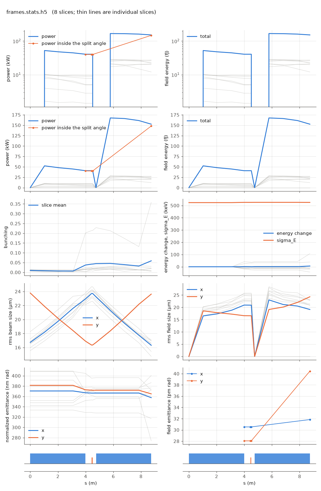

<!-- Generated by report_examples.py from examples/frames/. Do not edit. -->



Everything on this page lives in and runs from `examples/frames/`.

The example runs in one command:

    ../../build-release/bin/lucifer lucifer.toml

A run writes its beam and its field at element ends. A visualization wants them along z inside the undulators, and it wants to follow a particle from one to the next. This deck turns on the frame series and the field's reductions, and cuts both to four slices of the window ([reading the output](../../reading-output.md)).

The deck runs two segments of the Aramis line with a 1 m comb and a window of 24 wavelengths at 3 wavelengths per slice, which is 8 slices. Each frame carries four of them, indices 3 to 6. A frame of each kind is written at every record, and the record count is in the table below with the run's other measured quantities. A beam frame is a fraction of a megabyte, a field frame about a megabyte, and the statistics file with the reductions a couple of megabytes, so everything the run wrote comes to some tens of megabytes.

The frame index is the statistics record index, so `frames-000006.beam.h5`, `frames-000006.wf.h5` and row 6 of `frames.stats.h5` are one position on the line. Frames land inside the undulators and not only at their ends, which is what riding the comb is for. At a 1 m comb on 8.74 m of line, six of the twelve fall strictly inside an undulator, two on an undulator's end, three in the break between the two, and one at the entry face.

Each file says where it was taken. `sPosition`, `elementName`, `phi0`, `sliceFirst` and `sliceLast` are on every frame. An FEL frame adds `aw`, `ku`, `helical` and `tilt`, and `floorPosition` and `floorAngles` place it in the lab. The averaged mode integrates the quiver away, so a reader that wants the physical orbit rebuilds it from `aw`, `ku` and `s`.

`run.migrate = true` is on so the labels have work to do. Every macroparticle carries a label, and the label follows the particle when migration moves it to a neighbouring slice. Across this series 4591 distinct labels appear in the four slices dumped, against 1024 per slice in any one frame. Particles cross into and out of the range as they slip, and a label that stops appearing has left it. The labels are what make the series trajectories rather than snapshots.

`run.dump_reduced = true` writes the field's intensity projections into the statistics file at every record: `xy_intensity`, `slice_x_intensity`, `slice_y_intensity` and the complex field on axis. They integrate back to `power` exactly and are two hundred times smaller than the field frames, so a picture of the run needs no field frame at all. The frames are here for the views that want the transverse profile of one slice at one position.

The slice range is what keeps the output small. The same deck over the whole window writes twice the bytes, and a run at one wavelength per slice with thousands of slices would write gigabytes a frame. [](../../performance.md) measures a full-size frame at 95 MB and the cost of compression, which does not pay on this data.

The run takes under a second.

## Measured on this run

The runner wrote these from each run's stats file and log, and the keystone regenerates them. A float carries five significant digits.

| Quantity | `lucifer.toml` | Unit |
|---|---|---|
| exit power | 1.5236e+05 | W |
| exit power per slice | 1.9045e+04 | W |
| exit power, rms over mean across slices | 4.4252e-01 |  |
| exit pulse energy | 1.5247e-13 | J |
| peak power | 1.6735e+05 | W |
| s of the peak power | 5.7811e+00 | m |
| mode peak, power inside the split | 1.4797e+05 | W |
| s of the mode peak | 8.7400e+00 | m |
| exit power inside the split | 1.4797e+05 | W |
| exit power outside the split | 4.3915e+03 | W |
| outside over inside, the run's maximum | 2.9678e-02 |  |
| outside over inside at the exit | 2.9678e-02 |  |
| split angle | 3.0742e-06 | rad |
| power at the first element end | 4.0678e+04 | W |
| power per slice at the first element end | 5.0847e+03 | W |
| initial bunching, mean |b| over slices | 9.8485e-03 |  |
| exit bunching, mean |b| over slices | 5.8875e-02 |  |
| exit bunching, the largest slice | 3.5821e-01 |  |
| bunching, the maximum along the line of the mean |b| | 5.8875e-02 |  |
| s of the bunching maximum | 8.7400e+00 | m |
| bunching at the mode peak | 3.7415e-02 |  |
| power of the largest slice at the bunching maximum | 2.7294e+04 | W |
| exit power of the largest slice | 2.7294e+04 | W |
| mean slice energy at the start | 5.8038e+09 | eV |
| mean slice energy at the exit | 5.8038e+09 | eV |
| mean slice energy, exit minus start | 6.2637e+03 | eV |
| slice energy spread at the start | 5.2351e+05 | eV |
| slice energy spread at the exit | 5.2519e+05 | eV |
| span of the slice energies at the exit, head to tail | 9.2083e+04 | eV |
| slices | 8 |  |
| records | 12 |  |
| slice spacing | 3.0000e-10 | m |
| macroparticles per slice | 1024 |  |
| grid points | 128 |  |
| grid cell | 3.1500e-06 | m |
| grid derived by setup | no |  |
| FEL steps | 178 |  |
| source filter, mode angle | 3.0740e-06 | rad |
| source filter, rho angle | 2.6430e-06 | rad |
| source filter, ratio of the angles | 1.1600e+00 |  |
| source filter, edge | 3.0742e-06 | rad |

## The input files

The deck, its variants, and any lattice they name, as they are on disk.

### `lucifer.toml`

```toml
lattice = "../aramis.bmad"

[run]
out_root = "frames"
track_end = "UND##2"
comb_ds_save = 1.0
dump_at_comb = true
dump_slice_first = 3
dump_slice_last = 6
dump_reduced = true
migrate = true

[window]
window_length = 2.4e-9
n_wavelength = 3

[beam]
n_particle = 1024
bunch_charge = 2.401661485427e-14
sig_pz = 8.804506566858e-5
a_norm_emit = 4e-7
b_norm_emit = 4e-7
z_distribution = "GRID"
z_min = -1.2e-9
z_max = 1.2e-9
shot_noise = true

[field]
lambda0 = 1e-10
grid_n_pts = 128
grid_half_width = 2e-4
seed_power = 0
```
