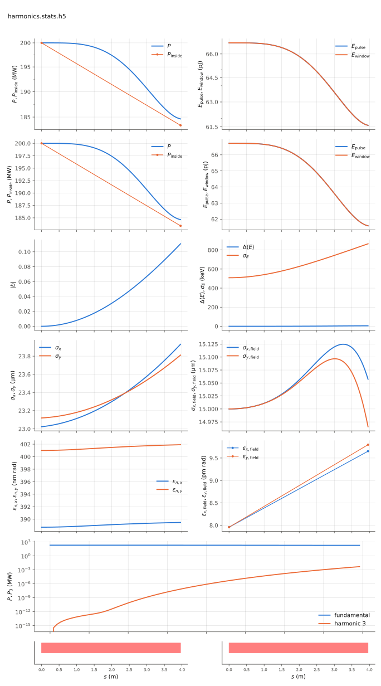

<!-- Generated by report_examples.py from examples/harmonics/. Do not edit. -->



Everything on this page lives in and runs from `examples/harmonics/`.

The example runs in one command, with Bmad only:

    ../../build-release/bin/lucifer lucifer.toml
    python -m lucifer.plot harmonics.stats.h5

This is a strongly seeded steady-state run on a planar segment carrying two radiation fields (`field.harmonics = [1, 3]`): the fundamental at 1 Angstrom and a third harmonic at 1/3 Angstrom. The harmonic starts dark and grows from the bunching the fundamental drives. That is nonlinear harmonic generation, at three times the fundamental's growth rate, since P3 rides |b3|^2 and b3 grows as b1^3.

The seed is 200 MW on 3.96 m of planar undulator at rms aw = 0.84853. Over the segment the fundamental gives up a small fraction of its seed power to the beam, and the third harmonic climbs from nothing through several decades. The measured quantities are in the table below. The exit power there is the fundamental's, and the harmonic's power along z is in the plot.

The summary figure's harmonic panel shows both curves on one log scale, and that figure is this example's page in the documentation. The harmonic's full wavefront_params live under `field/harm3/` in the stats file. Its dump carries `-h3` in the name, `harmonics-final-h3.wf.h5`, an openPMD EXT_Wavefront file with the photon energy identifying the harmonic.

A helical undulator would give nothing here, since its coupling fc(h) vanishes for every harmonic (the manual's harmonic-radiation section). That is why this example is planar. The input file turns the source filter off, as the comparison against Genesis 1.3 Version 4 (Genesis4) requires. The validation suite's harmonics section runs the same configuration against Genesis4, on the fundamental's power and on the harmonic's growth, and against the exact Bessel deposit sum, at the levels in [](../../validation.md#val-levels-harmonics).

The run takes about a second.

## Measured on this run

The runner wrote these from each run's stats file and log, and the keystone regenerates them. A float carries five significant digits.

| Quantity | `lucifer.toml` | Unit |
|---|---|---|
| exit power | 1.8464e+08 | W |
| exit power per slice | 1.8464e+08 | W |
| exit window energy | 6.1589e-11 | J |
| exit pulse energy, the window's and the light slipped out of it | 6.1589e-11 | J |
| peak power | 2.0000e+08 | W |
| s of the peak power | 1.8000e-01 | m |
| mode peak, power inside the split | 2.0000e+08 | W |
| s of the mode peak | 0.0000e+00 | m |
| exit power inside the split | 1.8340e+08 | W |
| exit power outside the split | 1.2439e+06 | W |
| outside over inside, the run's maximum | 1.5550e-06 |  |
| outside over inside at the exit | 6.7825e-03 |  |
| split angle | 2.7594e-06 | rad |
| power at the first element end | 1.8464e+08 | W |
| power per slice at the first element end | 1.8464e+08 | W |
| initial bunching, mean |b| over slices | 3.9886e-17 |  |
| exit bunching, mean |b| over slices | 1.1071e-01 |  |
| exit bunching, the largest slice | 1.1071e-01 |  |
| bunching, the maximum along the line of the mean |b| | 1.1071e-01 |  |
| s of the bunching maximum | 3.9600e+00 | m |
| bunching at the mode peak | 3.9886e-17 |  |
| power of the largest slice at the bunching maximum | 1.8464e+08 | W |
| exit power of the largest slice | 1.8464e+08 | W |
| mean slice energy at the start | 5.8038e+09 | eV |
| mean slice energy at the exit | 5.8038e+09 | eV |
| mean slice energy, exit minus start | 5.0518e+03 | eV |
| slice energy spread at the start | 5.0879e+05 | eV |
| slice energy spread at the exit | 8.6474e+05 | eV |
| span of the slice energies at the exit, head to tail | 0.0000e+00 | eV |
| slices | 1 |  |
| records | 89 |  |
| slice spacing | 1.0000e-10 | m |
| macroparticles per slice | 8192 |  |
| grid points | 128 |  |
| grid cell | 3.1500e-06 | m |
| grid derived by setup | no |  |
| FEL steps | 88 |  |
| exit power, the harm3 component | 4.8069e+03 | W |

## The input files

The input file, its variants, and any lattice they name, as they are on disk.

### `lucifer.toml`

```toml
lattice = "harmonics.bmad"

[run]
out_root = "harmonics"
source_filter = false
ran_seed = 12345

[beam]
n_particle = 8192
bunch_charge = 1.000692285594e-15
sig_z = 0
sig_pz = 8.804506566858e-5
a_norm_emit = 4e-7
b_norm_emit = 4e-7

[field]
lambda0 = 1e-10
grid_n_pts = 128
grid_half_width = 2e-4
seed_power = 2e8
seed_waist_size = 30e-6
harmonics = [1, 3]
```

### `harmonics.bmad`

```fortran
! Harmonic-lasing example lattice: one planar undulator segment at the Benchmark1-SASE
! energy and rms aw (planar, so the odd-harmonic couplings fc(h) are alive -- a
! helical device couples only the fundamental). Resonant at 1 Angstrom, and the
! third harmonic radiates at 1/3 Angstrom. Production defaults: the averaged FEL method
! on Bmad's own kernel maps, ds_step = 3 periods.

no_digested
parameter[geometry] = open
parameter[particle] = electron
parameter[e_tot] = 11357.82 * m_electron

beginning[beta_a] = 15
beginning[beta_b] = 15

UNDP: wiggler, l = 3.96, l_period = 0.015, field_calc = planar_model, &
      b_max = sqrt(2) * 0.84853 * (twopi / 0.015) * m_electron / c_light, &
      fel_method = averaged, ds_step = 0.045

SEGP: line = (UNDP)

use, SEGP
```
