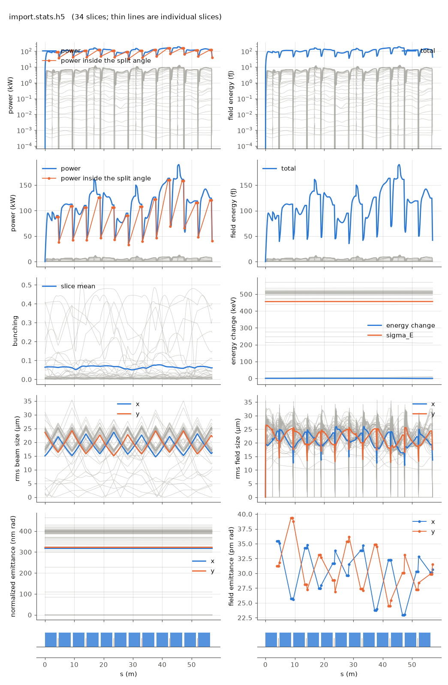

<!-- Generated by report_examples.py from examples/import/. Do not edit. -->



Everything on this page lives in and runs from `examples/import/`.

The example runs in two commands, with Bmad only:

    ../../build-release/bin/lucifer lucifer.toml
    ../../build-release/bin/lucifer lucifer_from_file.in
    python ../plot_fel.py import.stats.h5

The bunch is described by Bmad's `beam_init_struct`, the native equivalent of what Genesis 1.3 Version 4 (Genesis4)'s `&beam` describes. It is loaded into FEL slices by each of the two `load_mode` settings and tracked dark through the full line: SASE from a real bunch (the manual's [loading section](../../fel-physics.md)).

The lattice is the whole optics specification. The reference energy comes from its `e_tot`, and the bunch is generated matched to the Twiss in its `beginning` statement, which is the FODO line's periodic solution. There is no `gamma0` knob and no `match` transform, because both would be a second way of saying what the lattice already says.

The bunch is a Gaussian test bunch sized to what the FEL window can afford: `sig_z = 1.2 nm` with 30 fC gives the benchmark 3 kA peak in a window a few hundred wavelengths long. A physical accelerator bunch is micrometers long and carries hundreds of pC. It needs thousands of slices and belongs to a production run rather than to an example.

`lucifer.toml` generates 50000 particles and keeps every one. `load_mode = "keep"` makes each particle a beamlet of eight phase copies at an eighth of its charge. The slices then hold as many macroparticles as the bunch put there, a handful in the tails and tens of thousands at the peak, 400000 in all. Every charge-weighted moment of the bunch is the load's, and the window is the bunch's own extent. `quiet_start = true` spreads the copies over 2 pi about each particle's phase. `shot_noise = true` imposes the physical noise on the beamlets after measuring that the load is quiet, 2.6e-29 in |b|^2 N_lambda before the noise goes on. The deck also writes the bunch with `write_openpmd_file` as `import_bunch.h5`, 2.8 MB of openPMD.

`lucifer_from_file.in` names that file in `beam.position_file` and loads it in the sample mode. `beam.n_particle = 2048` macroparticles go into every slice, resampled by Genesis4's `importdistribution` method from the particles that fell into each slice's sampling window, with the current taken from the same window. The same slices come out, since both modes bin the same bunch on the same spacing. `write_genesis_dist` writes the same bunch as a Genesis4 distribution file for its `&importdistribution`.

On these inputs both modes exit far below saturation, a startup from a real bunch rather than a saturated FEL. The measured quantities are in the table below, the slice count and the peak slice's macroparticle count among them. The two exit powers differ, and the two runs are different SASE realizations of the same physics. The keep mode draws no random number before the noise and the sample mode draws for every resampled particle, so the noise falls on different phasors. In a dark start a small change in the load re-rolls the realization, as the per-slice spread of `../sase` shows. The keep mode costs what its 400000 macroparticles cost. A production run with a bunch from an accelerator simulation would keep fewer copies or sample.

The run reports the split between the mode and the wide-angle emission of the point beamlets. That emission comes from macroparticles that occupy one grid point each, and no real beam radiates it ([SASE convergence](../../startup-noise.md)). At the exit the power outside the split angle is a few percent of the power inside it in both modes, and the table carries the ratio. With the filter off the same decks reported far more power, nearly all of it that emission, which is why the exit powers here are the mode. Both modes load the same bunch on the same grid, so the comparison between them is unaffected.

## Measured on this run

The runner wrote these from each run's stats file and log, and the keystone regenerates them. A float carries five significant digits.

| Quantity | `lucifer.toml` | `lucifer_from_file.toml` | Unit |
|---|---|---|---|
| exit power | 4.1816e+04 | 8.6549e+04 | W |
| exit power per slice | 1.2299e+03 | 2.5456e+03 | W |
| exit power, rms over mean across slices | 1.6403e+00 | 1.7227e+00 |  |
| exit pulse energy | 4.1845e-14 | 8.6609e-14 | J |
| peak power | 1.9034e+05 | 3.2155e+05 | W |
| s of the peak power | 4.5574e+01 | 2.5633e+01 | m |
| mode peak, power inside the split | 1.5995e+05 | 2.8497e+05 | W |
| s of the mode peak | 4.2510e+01 | 4.5100e+00 | m |
| exit power inside the split | 4.0194e+04 | 8.2287e+04 | W |
| exit power outside the split | 1.6223e+03 | 4.2617e+03 | W |
| outside over inside, the run's maximum | 2.1939e-02 | 3.2999e-02 |  |
| outside over inside at the exit | 4.0363e-02 | 5.1790e-02 |  |
| split angle | 2.9795e-06 | 2.9914e-06 | rad |
| gain length, the shortest e-folding length over five consecutive records | 4.7782e+00 | 3.8292e+00 | m |
| power at the first element end | 9.0333e+04 | 2.9438e+05 | W |
| power per slice at the first element end | 2.6568e+03 | 8.6581e+03 | W |
| initial bunching, mean |b| over slices | 6.4530e-02 | 1.3340e-02 |  |
| exit bunching, mean |b| over slices | 6.1271e-02 | 1.1616e-02 |  |
| exit bunching, the largest slice | 4.0166e-01 | 2.5148e-02 |  |
| bunching, the maximum along the line of the mean |b| | 7.7367e-02 | 1.6281e-02 |  |
| s of the bunching maximum | 3.8941e+01 | 4.5100e+00 | m |
| bunching at the mode peak | 6.7908e-03 | 8.5572e-03 |  |
| power of the largest slice at the bunching maximum | 8.7907e+03 | 1.9930e+04 | W |
| exit power of the largest slice | 7.0747e+03 | 1.3827e+04 | W |
| mean slice energy at the start | 5.8038e+09 | 5.8038e+09 | eV |
| mean slice energy at the exit | 5.8038e+09 | 5.8038e+09 | eV |
| mean slice energy, exit minus start | 1.2734e+02 | -5.6585e+01 | eV |
| slice energy spread at the start | 4.5587e+05 | 4.3733e+05 | eV |
| slice energy spread at the exit | 4.5632e+05 | 4.3771e+05 | eV |
| span of the slice energies at the exit, head to tail | 1.5102e+06 | 1.0733e+06 | eV |
| slices | 34 | 34 |  |
| records | 1105 | 1105 |  |
| slice spacing | 3.0000e-10 | 3.0000e-10 | m |
| macroparticles per slice | 40320 | 2048 |  |
| grid points | 256 | 256 |  |
| grid cell | 1.5690e-06 | 1.5690e-06 | m |
| grid derived by setup | no | no |  |
| FEL steps | 1068 | 1068 |  |
| source filter, mode angle | 2.9790e-06 | 2.9910e-06 | rad |
| source filter, rho angle | 2.6200e-06 | 2.6320e-06 | rad |
| source filter, ratio of the angles | 1.1400e+00 | 1.1400e+00 |  |
| source filter, edge | 2.9794e-06 | 2.9914e-06 | rad |

## The input files

The deck, its variants, and any lattice they name, as they are on disk.

### `lucifer.toml`

```toml
lattice = "../aramis.bmad"

[run]
out_root = "import"
ran_seed = 12345

[window]
n_wavelength = 3

[beam]
n_particle = 50000
bunch_charge = 3.01e-14
sig_z = 1.2e-9
sig_pz = 8.8045e-5
a_norm_emit = 4e-7
b_norm_emit = 4e-7
load_mode = "keep"
quiet_start = true
beamlet_size = 8
shot_noise = true
write_openpmd_file = "import_bunch.h5"

[field]
lambda0 = 1e-10
grid_n_pts = 256
grid_half_width = 2e-4
seed_power = 0
```

### `lucifer_from_file.toml`

```toml
lattice = "../aramis.bmad"

[run]
out_root = "from_file"
ran_seed = 12345

[window]
n_wavelength = 3

[beam]
position_file = "import_bunch.h5"
n_particle = 2048
load_mode = "sample"
quiet_start = true
beamlet_size = 8
shot_noise = true

[beam.resample]
slice_width = 0.01

[field]
lambda0 = 1e-10
grid_n_pts = 256
grid_half_width = 2e-4
seed_power = 0
```
