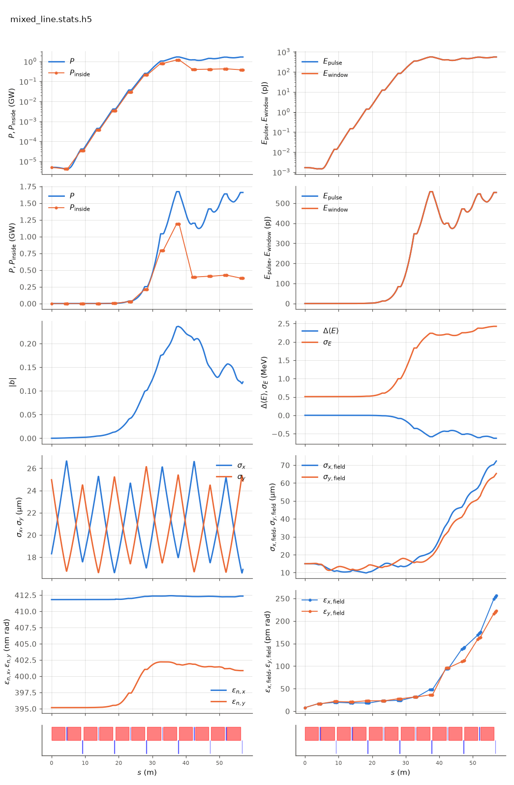

<!-- Generated by report_examples.py from examples/mixed_line/. Do not edit. -->



Everything on this page lives in and runs from `examples/mixed_line/`.

The example runs in two commands, with Bmad only:

    ../../build-release/bin/lucifer lucifer.toml
    ../../build-release/bin/lucifer lucifer_averaged.toml
    python -m lucifer.plot mixed_line.stats.h5

The FEL method is an element attribute, so a line whose segments are tracked differently is a line of elements that differ. `mixed.bmad` calls `../aramis.bmad` for its parameters, defines `UNDU` as the same undulator carrying `fel_method = unaveraged`, and puts one `UNDU` in the third FODO cell. Eleven segments run the averaged default and the fifth runs unaveraged, integrating the real helical field with no period averaging (the manual's [unaveraged-mode section](../../fel-physics.md)).

`lucifer_averaged.toml` is the all-averaged twin, which overrides that one element back to the default. The two runs differ in one segment's method and in nothing else.

On this input, a seeded steady state, the two runs are bit-identical up to the first record inside `UNDU`, at z = 19.045 m, and differ from there. The measured quantities are in the table below, the exit power of each run and the step count that the one unaveraged segment adds among them.

In the plot the log-power panel runs straight through the boundary at 19 to 23 m, with no step and no kink where the method changes, and saturation arrives at the same place on both lines. A difference of a few percent is not visible on a six-decade axis, which is why the table is the check and the plot is the sanity check.

The two curves are bit-identical up to the method boundary, which is the check that the mixing itself is what differs. Through the unaveraged segment they separate by a few percent in ln P, and they stay within that at the exit. Two formulations of the same physics, sharing no approximation, hand the same beam and field back and forth across an element boundary.

The cost is where the difference is spent. The one unaveraged segment takes most of the run's wall time at 20 substeps per period, and the eleven averaged segments share the rest. Per-element selection puts the expensive method in the segment where it is wanted and the cheap one everywhere else.

Collective effects are refused in a line with any unaveraged segment, so this example carries none, and the benchmark checks the refusal.

The benchmark runs the same configuration as its sandwich check. There the mixed line must agree with the all-averaged line at the exit, the energy ledger rows must appear only inside the unaveraged segment, and a wake on that segment must be refused ([validation](../../validation.md)). This directory is the runnable version of that check.

The run reports the split between the mode and the wide-angle emission of the point beamlets. That emission comes from macroparticles that occupy one grid point each, and no real beam radiates it ([SASE convergence](../../startup-noise.md)). At the exit the power outside the split angle is several times the power inside it in both runs, so most of each exit power is that emission. The table carries the exit power inside and outside the split for both runs, so the difference between them can be read in the mode as well as in the total. Both input files state `run.source_filter = false`, so the two FEL methods compare like for like. The filter reaches the averaged elements only and would filter eleven segments of one line and twelve of the other.

The run takes a few seconds, and the averaged twin about a second.

## Measured on this run

The runner wrote these from each run's stats file and log, and the keystone regenerates them. A float carries five significant digits.

| Quantity | `lucifer.toml` | `lucifer_averaged.toml` | Unit |
|---|---|---|---|
| exit power | 1.6598e+09 | 1.6863e+09 | W |
| exit power per slice | 1.6598e+09 | 1.6863e+09 | W |
| exit window energy | 5.5366e-10 | 5.6247e-10 | J |
| exit pulse energy, the window's and the light slipped out of it | 5.5366e-10 | 5.6247e-10 | J |
| peak power | 1.6722e+09 | 1.6863e+09 | W |
| s of the peak power | 3.7760e+01 | 5.6760e+01 | m |
| mode peak, power inside the split | 1.1880e+09 | 1.1814e+09 | W |
| s of the mode peak | 3.8000e+01 | 3.8000e+01 | m |
| exit power inside the split | 3.8097e+08 | 3.8720e+08 | W |
| exit power outside the split | 1.2789e+09 | 1.2991e+09 | W |
| outside over inside, the run's maximum | 4.0755e-01 | 4.1176e-01 |  |
| outside over inside at the exit | 3.3569e+00 | 3.3550e+00 |  |
| split angle | 2.9077e-06 | 2.9077e-06 | rad |
| gain length, the shortest e-folding length over five consecutive records | 1.8661e+00 | 1.8661e+00 | m |
| power at the first element end | 4.4159e+03 | 4.4159e+03 | W |
| power per slice at the first element end | 4.4159e+03 | 4.4159e+03 | W |
| initial bunching, mean |b| over slices | 3.6362e-17 | 3.6362e-17 |  |
| exit bunching, mean |b| over slices | 1.1891e-01 | 1.1251e-01 |  |
| exit bunching, the largest slice | 1.1891e-01 | 1.1251e-01 |  |
| bunching, the maximum along the line of the mean |b| | 2.3638e-01 | 2.3623e-01 |  |
| s of the bunching maximum | 3.7760e+01 | 3.7760e+01 | m |
| bunching at the mode peak | 2.3538e-01 | 2.3527e-01 |  |
| power of the largest slice at the bunching maximum | 1.6722e+09 | 1.6678e+09 | W |
| exit power of the largest slice | 1.6598e+09 | 1.6863e+09 | W |
| mean slice energy at the start | 5.8038e+09 | 5.8038e+09 | eV |
| mean slice energy at the exit | 5.8032e+09 | 5.8032e+09 | eV |
| mean slice energy, exit minus start | -6.2473e+05 | -6.3359e+05 | eV |
| slice energy spread at the start | 5.0869e+05 | 5.0869e+05 | eV |
| slice energy spread at the exit | 2.4231e+06 | 2.4181e+06 | eV |
| span of the slice energies at the exit, head to tail | 0.0000e+00 | 0.0000e+00 | eV |
| slices | 1 | 1 |  |
| records | 1105 | 1105 |  |
| slice spacing | 1.0000e-10 | 1.0000e-10 | m |
| macroparticles per slice | 2048 | 2048 |  |
| grid points | 128 | 128 |  |
| grid cell | 3.1500e-06 | 3.1500e-06 | m |
| grid derived by setup | no | no |  |
| FEL steps | 6319 | 1068 |  |

## The input files

The input file, its variants, and any lattice they name, as they are on disk.

### `lucifer.toml`

```toml
lattice = "mixed.bmad"

[run]
out_root = "mixed_line"
source_filter = false

[beam]
n_particle = 2048
bunch_charge = 1.000692285594e-15
sig_z = 0
sig_pz = 8.804506566858e-5
a_norm_emit = 4e-7
b_norm_emit = 4e-7

[field]
lambda0 = 1e-10
grid_n_pts = 128
grid_half_width = 2e-4
seed_power = 5e3
seed_waist_size = 30e-6
```

### `lucifer_averaged.toml`

```toml
lattice = "mixed_averaged.bmad"

[run]
out_root = "mixed_averaged"
source_filter = false

[beam]
n_particle = 2048
bunch_charge = 1.000692285594e-15
sig_z = 0
sig_pz = 8.804506566858e-5
a_norm_emit = 4e-7
b_norm_emit = 4e-7

[field]
lambda0 = 1e-10
grid_n_pts = 128
grid_half_width = 2e-4
seed_power = 5e3
seed_waist_size = 30e-6
```

### `mixed.bmad`

```fortran
! The benchmark line with one segment tracked unaveraged and the other eleven averaged.
! The tracking method is an element attribute, so a mixed line is a line of elements
! that differ, exactly as the tapered line is (fel-physics.md sec-element).

call, file = ../aramis.bmad

UNDU: UND, fel_method = unaveraged

CELL:  line = (UND,  D1, QF, D2, UND, D1, QD, D2)
CELLU: line = (UNDU, D1, QF, D2, UND, D1, QD, D2)
MIXED: line = (2*CELL, CELLU, 3*CELL)

use, MIXED
```

### `mixed_averaged.bmad`

```fortran
! The all-averaged twin of mixed.bmad: the one unaveraged segment overridden back to
! the default, so the two runs differ in that segment's method and nothing else.

call, file = mixed.bmad

UNDU[FEL_METHOD] = averaged
```
