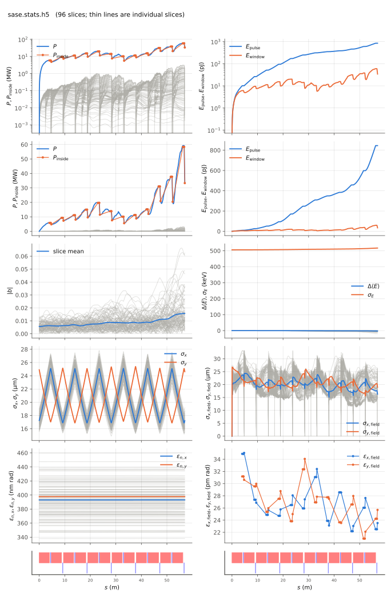

<!-- Generated by report_examples.py from examples/sase/. Do not edit. -->



Everything on this page lives in and runs from `examples/sase/`.

The example runs in one command, with Bmad only:

    ../../build-release/bin/lucifer lucifer.toml
    python -m lucifer.plot sase.stats.h5

This is self-amplified spontaneous emission from nothing but the electrons. The loader generates a time window of slices spaced an integer number of wavelengths apart, imposes physical shot noise by weighted Fawley loading, and starts the field dark (`seed_power = 0`). The FEL then grows through the full line with slippage active. Before imposing the noise the loader prints the per-slice electron count `N_lambda`, the effective count `N_eff`, and the quiet floor it verified. The noise level is therefore a reported number.

The exit power of a run like this one is set by the transverse cell size and the macroparticle count as much as by the physics, since each beamlet radiates into every angle the grid carries. The SASE convergence page measures that and says how to choose the grid, the window and the load. `run.source_filter = true` suppresses the wide-angle part, with its edge derived from the beam and the gain and printed at setup. Every run also reports `power_inside_angle` beside the total power at each element end, so the separation is in the stats file without a dump.

The beam is a flat coasting bunch in Bmad's own vocabulary: `distribution_type(3) = "GRID"` over the window extent. The current is derived as `I = Q*c/extent`, so `bunch_charge` encodes 3 kA exactly.

On this input (`ran_seed` at its 12345 default) the startup power settles after the first segment, grows through the line, and fluctuates from slice to slice at the exit, which is the SASE fluctuation. The slice energy spread grows by a few percent over the line. The measured quantities are in the table below on the example's page: the power per slice after the first element, the exit power, its rms over mean across the slices, and the energy spread at the start and the exit. With the source filter off the same input file reports nearly two orders of magnitude more power at the exit, almost all of it the wide-angle emission of the point beamlets ([the convergence section](../../fel-physics.md#sec-convergence)).

Two features of the plot are physics and not artifacts. The total-power sawtooth is radiation slipping out of the head of a finite time window at each drift while fresh vacuum enters at the tail. Genesis 1.3 Version 4 (Genesis4) shows the same sawtooth, as does any finite window. Deep saturation of every slice needs a window longer than the total slippage. The per-slice lines in the power panel are the slippage cascade itself.

Most of the light this run makes leaves the window. The window's field energy peaks at 59 pJ and ends at 34 pJ, while the whole pulse, the window's energy and the light that slipped out of it, ends at 845 pJ. The summary figure draws the two energies in one panel. `run.keep_escaped_field` is on by default, so the run banks what slips out and writes the whole pulse at the exit as `sase-pulse.wf.h5`, 1.34 GB on this window, an openPMD wavefront file that openpmd-beamphysics reads ([reading an output file](../../reading-output.md)). The header's `Bank` line states those bytes before the run tracks. `run.write_escaped = true` also writes the bank itself as `sase-escaped.wf.h5`, each slice as it left the window, 1.24 GB more. Setting `run.keep_escaped_field` to false drops the pulse, and the stats file still records the escaped and pulse energies.

The run reports the split between the mode and the wide-angle emission of the point beamlets. That emission comes from macroparticles that occupy one grid point each, and no real beam radiates it ([SASE convergence](../../startup-noise.md)). The filter is on by default and this input file runs with it. At the exit the power outside the split angle is a few percent of the power inside it, so the exit power is the mode. With the filter off the same input file reports far more power, nearly all of it that emission. Four times the macroparticles is not enough on this window without the filter. Leaving the grid out of the input file derives a coarser grid with half the points of this one. Two grids a factor of two apart in cell size then agree to within ten percent once the artifact is gone.

The run takes about half a minute.

## Measured on this run

The runner wrote these from each run's stats file and log, and the keystone regenerates them. A float carries five significant digits.

| Quantity | `lucifer.toml` | Unit |
|---|---|---|
| exit power | 3.3963e+07 | W |
| exit power per slice | 3.5378e+05 | W |
| exit power, rms over mean across slices | 1.3124e+00 |  |
| exit window energy | 3.3986e-11 | J |
| exit pulse energy, the window's and the light slipped out of it | 8.4538e-10 | J |
| peak power | 5.9252e+07 | W |
| s of the peak power | 5.6760e+01 | m |
| mode peak, power inside the split | 5.8352e+07 | W |
| s of the mode peak | 5.6760e+01 | m |
| exit power inside the split | 3.3335e+07 | W |
| exit power outside the split | 6.2773e+05 | W |
| outside over inside, the run's maximum | 1.5419e-02 |  |
| outside over inside at the exit | 1.8831e-02 |  |
| split angle | 2.9625e-06 | rad |
| gain length, the shortest e-folding length over five consecutive records | 5.2559e+00 | m |
| power at the first element end | 6.0902e+06 | W |
| power per slice at the first element end | 6.3440e+04 | W |
| initial bunching, mean |b| over slices | 5.6750e-03 |  |
| exit bunching, mean |b| over slices | 1.5675e-02 |  |
| exit bunching, the largest slice | 6.2565e-02 |  |
| bunching, the maximum along the line of the mean |b| | 1.5717e-02 |  |
| s of the bunching maximum | 5.6240e+01 | m |
| bunching at the mode peak | 1.5668e-02 |  |
| power of the largest slice at the bunching maximum | 3.1217e+06 | W |
| exit power of the largest slice | 1.9297e+06 | W |
| mean slice energy at the start | 5.8038e+09 | eV |
| mean slice energy at the exit | 5.8038e+09 | eV |
| mean slice energy, exit minus start | -2.1499e+03 | eV |
| slice energy spread at the start | 5.0577e+05 | eV |
| slice energy spread at the exit | 5.1684e+05 | eV |
| span of the slice energies at the exit, head to tail | 1.5478e+05 | eV |
| slices | 96 |  |
| records | 1105 |  |
| slice spacing | 3.0000e-10 | m |
| macroparticles per slice | 2048 |  |
| grid points | 256 |  |
| grid cell | 1.5690e-06 | m |
| grid derived by setup | no |  |
| FEL steps | 1068 |  |
| source filter, mode angle | 2.9620e-06 | rad |
| source filter, rho angle | 2.6100e-06 | rad |
| source filter, ratio of the angles | 1.1300e+00 |  |
| source filter, edge | 2.9625e-06 | rad |

## The input files

The input file, its variants, and any lattice they name, as they are on disk.

### `lucifer.toml`

```toml
lattice = "../aramis.bmad"

[run]
out_root = "sase"

[window]
window_length = 2.88e-8
n_wavelength = 3

[beam]
n_particle = 2048
bunch_charge = 2.881993782512e-13
sig_pz = 8.804506566858e-5
a_norm_emit = 4e-7
b_norm_emit = 4e-7
z_distribution = "GRID"
z_min = -1.44e-8
z_max = 1.44e-8
shot_noise = true

[field]
lambda0 = 1e-10
grid_n_pts = 256
grid_half_width = 2e-4
seed_power = 0
```
