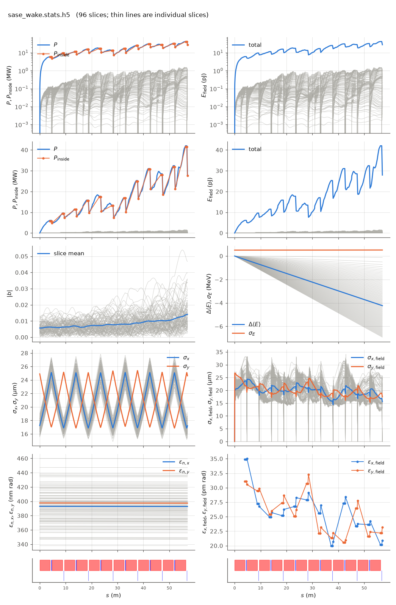

<!-- Generated by report_examples.py from examples/sase_wake/. Do not edit. -->



Everything on this page lives in and runs from `examples/sase_wake/`.

The example runs in one command, with Bmad only:

    ../../build-release/bin/lucifer lucifer.toml
    python -m lucifer.plot sase_wake.stats.h5

This is the `../sase` run through a deliberately narrow copper chamber of 0.5 mm radius, with the undulator gap wake and a 100 nm rough surface added. All three wake families are transcribed from Genesis 1.3 Version 4 (Genesis4) and act as a per-slice energy-loss rate. The resistive wall acts through the numerical impedance of Bane and Stupakov, the gap wake is convolved with dI/ds, and roughness acts through the complex-q contour (the manual's [wakes section](../../fel-physics.md)).

The chamber is a demonstration case. At 5.8 GeV and 1 Angstrom a normal chamber's wake is small, and this radius makes the physics visible in one run.

On this input the run writes the per-slice energy-loss rate to `sase_wake.wake.txt` at 1.94 to 121.5 keV/m across the window. The head slices lose least, because the wake is causal and the head has little charge ahead of it. The mean energy drops over the 57 m line by the energy change in the table, and the drop varies across the window by the span the table gives at the exit. The drop is visible in the energy panel against the initial spread. The SASE still lases, to an exit power below the `../sase` run's. The measured quantities are in the table below on the example's page. The power of an unseeded run depends on the grid and the particle count of its input ([SASE convergence](../../startup-noise.md)).

The same resistive-wall kernel applied through Bmad's own wake machinery instead of the transcribed model is `../bmad_wake`, which carries both runs and their agreement. What a loss this size does to the ponderomotive phases is `../migration`.

The run reports the split between the mode and the wide-angle emission of the point beamlets. That emission comes from macroparticles that occupy one grid point each, and no real beam radiates it ([SASE convergence](../../startup-noise.md)). At the exit the power outside the split angle is about a percent of the power inside it, so the exit power is the mode. With the filter off the same input file reports far more power, nearly all of it that emission. The wake's effect is measured on the beam and on the energy panel, which the split does not touch.

The run takes about half a minute.

## Measured on this run

The runner wrote these from each run's stats file and log, and the keystone regenerates them. A float carries five significant digits.

| Quantity | `lucifer.toml` | Unit |
|---|---|---|
| exit power | 2.7890e+07 | W |
| exit power per slice | 2.9052e+05 | W |
| exit power, rms over mean across slices | 1.1168e+00 |  |
| exit window energy | 2.7909e-11 | J |
| exit pulse energy, the window's and the light slipped out of it | 7.9246e-10 | J |
| peak power | 4.2003e+07 | W |
| s of the peak power | 5.6760e+01 | m |
| mode peak, power inside the split | 4.1557e+07 | W |
| s of the mode peak | 5.6760e+01 | m |
| exit power inside the split | 2.7577e+07 | W |
| exit power outside the split | 3.1333e+05 | W |
| outside over inside, the run's maximum | 1.0737e-02 |  |
| outside over inside at the exit | 1.1362e-02 |  |
| split angle | 2.9625e-06 | rad |
| gain length, the shortest e-folding length over five consecutive records | 5.9703e+00 | m |
| power at the first element end | 6.0771e+06 | W |
| power per slice at the first element end | 6.3303e+04 | W |
| initial bunching, mean |b| over slices | 5.6750e-03 |  |
| exit bunching, mean |b| over slices | 1.4149e-02 |  |
| exit bunching, the largest slice | 4.6745e-02 |  |
| bunching, the maximum along the line of the mean |b| | 1.4149e-02 |  |
| s of the bunching maximum | 5.7000e+01 | m |
| bunching at the mode peak | 1.4066e-02 |  |
| power of the largest slice at the bunching maximum | 1.2272e+06 | W |
| exit power of the largest slice | 1.2272e+06 | W |
| mean slice energy at the start | 5.8038e+09 | eV |
| mean slice energy at the exit | 5.7996e+09 | eV |
| mean slice energy, exit minus start | -4.2328e+06 | eV |
| slice energy spread at the start | 5.0577e+05 | eV |
| slice energy spread at the exit | 5.1382e+05 | eV |
| span of the slice energies at the exit, head to tail | 6.8405e+06 | eV |
| slices | 96 |  |
| records | 1105 |  |
| slice spacing | 3.0000e-10 | m |
| macroparticles per slice | 2048 |  |
| grid points | 256 |  |
| grid cell | 1.5690e-06 | m |
| grid derived by setup | no |  |
| FEL steps | 1068 |  |
| source filter, mode angle | 2.9620e-06 | rad |
| source filter, rho angle | 2.6100e-06 | rad |
| source filter, ratio of the angles | 1.1300e+00 |  |
| source filter, edge | 2.9625e-06 | rad |

## The input files

The input file, its variants, and any lattice they name, as they are on disk.

### `lucifer.toml`

```toml
lattice = "../aramis.bmad"

[run]
out_root = "sase_wake"

[window]
window_length = 2.88e-8
n_wavelength = 3

[beam]
n_particle = 2048
bunch_charge = 2.881993782512e-13
sig_pz = 8.804506566858e-5
a_norm_emit = 4e-7
b_norm_emit = 4e-7
z_distribution = "GRID"
z_min = -1.44e-8
z_max = 1.44e-8
shot_noise = true

[field]
lambda0 = 1e-10
grid_n_pts = 256
grid_half_width = 2e-4
seed_power = 0

[wake]
on = true
radius = 0.5e-3
material = "CU"
gap = 0.5e-3
lgap = 0.015
hrough = 100e-9
lrough = 100e-6
```
