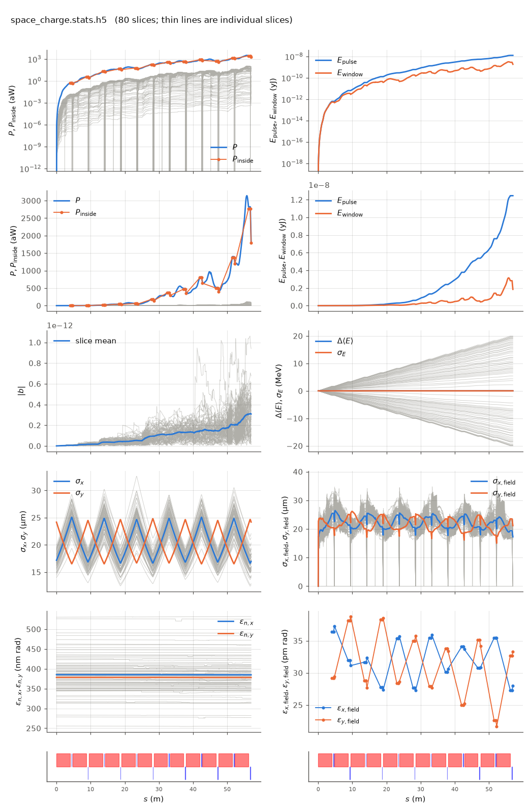

<!-- Generated by report_examples.py from examples/space_charge/. Do not edit. -->



Everything on this page lives in and runs from `examples/space_charge/`.

The example runs in four commands, with Bmad only:

    ../../build-release/bin/lucifer lucifer.toml
    ../../build-release/bin/lucifer lucifer_off.toml
    ../../build-release/bin/lucifer lucifer_short_range.toml
    ../../build-release/bin/lucifer lucifer_gate_off.toml
    python -m lucifer.plot space_charge.stats.h5

Space charge enters the pendulum equation as a per-particle `ez`, from per-slice radial-harmonic solves plus a whole-window long-range term (the manual's [space-charge section](../../fel-physics.md)). The two terms answer different questions, so this example measures them separately.

The elements say where it acts. `sc_line.bmad` calls the shared lattice and sets Bmad's own attribute on the undulators, `wiggler::*[SPACE_CHARGE_METHOD] = slice`, and the input files turn on Bmad's master switch, `bmad.csr_and_space_charge_on`. The FEL slices are the bins the solve uses, so Bmad's `space_charge_com` `n_bin`, set in the lattice file plays no part in it. `space_charge.` in the input file holds the solver's numbers and nothing about whether it runs.

`lucifer.toml` and `lucifer_off.toml` isolate the long-range term on a cold dark beam: a 4 nm Gaussian bunch at 3 kA peak, no seed and no shot noise, so space charge is the only channel that can change any particle's energy. The control run is the proof of that. With space charge off, every slice's mean energy is unchanged to the last bit over 57 m.

The measured quantities of the four input files are in the table below, the head-to-tail span of the slice mean energies at the exit among them, with the control run's exact zero beside it. The long-range term gives all of the span, and the two short-range harmonics the input file sets give none of it.

The beam-energy panel of the plot is the whole result: a symmetric fan opening from zero to half the span either side, with the mean and the energy spread both flat on zero through all 57 m. The bunch pushes itself apart, the tail losing energy and the head gaining it, and the mean is preserved because the force is internal. The power panels show femtowatt numbers, which are the dark run's numerical floor and not light. A 4 nm bunch is 13 attoseconds long, which is where this matters. Lengthening it ten times at the same 3 kA peak, by scaling `sig_z`, `bunch_charge` and `window_length` together, drops the span to about a third. The effect weakens with bunch length and not in proportion to it. A 4 nm bunch is far shorter than the beam's own 20 micrometer transverse size, and the simple line-charge scaling does not hold there.

The chirp matters at this size. Relative to the beam energy the span is more than twenty times the bandwidth that the gain length of `../steady_state` implies, so a bunch this short does not lase without something to compensate it.

The short-range harmonics measure exactly zero here, which is correct. They act on the density structure inside a slice, and a quiet-start dark beam has none, since the initial bunching sits at the quiet start's floor. `lucifer_short_range.toml` gives them something to act on, by matching the `../steady_state` input file parameter for parameter and adding `nz = 4, nphi = 1`. Against that run as its control, whose exit power and bunching its own page carries, the short-range input file's exit power is higher by about half a percent. That rise comes past saturation, from the short-range term acting on a beam the FEL has bunched.

Two configurations are refused. `slice` with neither term configured, `nz = 0` and `longrange = false`, is refused, since the solve would run at its full cost and return an exact zero. `fft_3d` on an FEL element is refused, since that solver wants a three-dimensional grid this walk does not build.

The master switch off while the elements still ask for `slice` is not refused, because that is how a lattice is run without space charge and without editing it. `lucifer_gate_off.toml` is that case: the same lattice, the same solver numbers, the switch false. The run prints a note saying so and tracks without space charge, measured as exactly the control run's zero.

The run reports the split between the mode and the wide-angle emission of the point beamlets. That emission comes from macroparticles that occupy one grid point each, and no real beam radiates it ([SASE convergence](../../startup-noise.md)). At the exit the power outside the split angle is a fraction of a percent of the power inside it on the short-range input file, so its exit power is the mode, as is the control's. With the filter off both reported nearly half of their power as that emission. The long-range input files start dark, and what the filter leaves of their femtowatt fields is a few percent outside the mode, which is why the comparison there is made on the beam.

Each run takes about seven seconds.

## Measured on this run

The runner wrote these from each run's stats file and log, and the keystone regenerates them. A float carries five significant digits.

| Quantity | `lucifer.toml` | `lucifer_gate_off.toml` | `lucifer_off.toml` | `lucifer_short_range.toml` | Unit |
|---|---|---|---|---|---|
| exit power | 1.8401e-15 | 1.2618e-15 | 1.2618e-15 | 8.0572e+08 | W |
| exit power per slice | 2.3002e-17 | 1.5773e-17 | 1.5773e-17 | 8.0572e+08 | W |
| exit power, rms over mean across slices | 1.1749e+00 | 1.1893e+00 | 1.1893e+00 |  |  |
| exit pulse energy | 1.8414e-33 | 1.2627e-33 | 1.2627e-33 | 2.6876e-10 | J |
| peak power | 3.1405e-15 | 1.8224e-15 | 1.8224e-15 | 1.5452e+09 | W |
| s of the peak power | 5.5747e+01 | 5.5612e+01 | 5.5612e+01 | 3.8179e+01 | m |
| mode peak, power inside the split | 2.7608e-15 | 1.7596e-15 | 1.7596e-15 | 1.5403e+09 | W |
| s of the mode peak | 5.6760e+01 | 5.6760e+01 | 5.6760e+01 | 3.7240e+01 | m |
| exit power inside the split | 1.7958e-15 | 1.2332e-15 | 1.2332e-15 | 8.0328e+08 | W |
| exit power outside the split | 4.4390e-17 | 2.8655e-17 | 2.8655e-17 | 2.4339e+06 | W |
| outside over inside, the run's maximum | 2.2083e-02 | 2.2506e-02 | 2.2506e-02 | 1.3790e-03 |  |
| outside over inside at the exit | 2.4719e-02 | 2.3237e-02 | 2.3237e-02 | 3.0300e-03 |  |
| split angle | 3.0130e-06 | 3.0130e-06 | 3.0130e-06 | 2.9661e-06 | rad |
| gain length, the shortest e-folding length over five consecutive records | 2.2869e+00 | 2.5485e+00 | 2.5485e+00 | 2.1113e+00 | m |
| power at the first element end | 5.3798e-19 | 1.7324e-18 | 1.7324e-18 | 4.1638e+03 | W |
| power per slice at the first element end | 6.7248e-21 | 2.1655e-20 | 2.1655e-20 | 4.1638e+03 | W |
| initial bunching, mean |b| over slices | 4.3667e-17 | 4.3667e-17 | 4.3667e-17 | 3.9886e-17 |  |
| exit bunching, mean |b| over slices | 3.0789e-13 | 2.4485e-13 | 2.4485e-13 | 2.4154e-01 |  |
| exit bunching, the largest slice | 9.3973e-13 | 9.8689e-13 | 9.8689e-13 | 2.4154e-01 |  |
| bunching, the maximum along the line of the mean |b| | 3.1327e-13 | 2.4485e-13 | 2.4485e-13 | 3.0185e-01 |  |
| s of the bunching maximum | 5.6760e+01 | 5.7000e+01 | 5.7000e+01 | 3.8448e+01 | m |
| bunching at the mode peak | 3.2578e-13 | 2.2396e-13 | 2.2396e-13 | 2.9978e-01 |  |
| power of the largest slice at the bunching maximum | 1.0999e-16 | 5.0996e-17 | 5.0996e-17 | 1.5405e+09 | W |
| exit power of the largest slice | 1.0158e-16 | 5.0996e-17 | 5.0996e-17 | 8.0572e+08 | W |
| mean slice energy at the start | 5.8038e+09 | 5.8038e+09 | 5.8038e+09 | 5.8038e+09 | eV |
| mean slice energy at the exit | 5.8038e+09 | 5.8038e+09 | 5.8038e+09 | 5.8036e+09 | eV |
| mean slice energy, exit minus start | -5.5882e+01 | 0.0000e+00 | 0.0000e+00 | -2.7033e+05 | eV |
| slice energy spread at the start | 0.0000e+00 | 0.0000e+00 | 0.0000e+00 | 5.0879e+05 | eV |
| slice energy spread at the exit | 1.8440e-06 | 0.0000e+00 | 0.0000e+00 | 2.5369e+06 | eV |
| span of the slice energies at the exit, head to tail | 4.0011e+07 | 0.0000e+00 | 0.0000e+00 | 0.0000e+00 | eV |
| slices | 80 | 80 | 80 | 1 |  |
| records | 1105 | 1105 | 1105 | 1105 |  |
| slice spacing | 3.0000e-10 | 3.0000e-10 | 3.0000e-10 | 1.0000e-10 | m |
| macroparticles per slice | 512 | 512 | 512 | 8192 |  |
| grid points | 128 | 128 | 128 | 256 |  |
| grid cell | 3.1500e-06 | 3.1500e-06 | 3.1500e-06 | 1.5690e-06 | m |
| grid derived by setup | no | no | no | no |  |
| FEL steps | 1068 | 1068 | 1068 | 1068 |  |
| source filter, mode angle | 3.0130e-06 | 3.0130e-06 | 3.0130e-06 | 2.9660e-06 | rad |
| source filter, rho angle | 2.6250e-06 | 2.6250e-06 | 2.6250e-06 | 2.6110e-06 | rad |
| source filter, ratio of the angles | 1.1500e+00 | 1.1500e+00 | 1.1500e+00 | 1.1400e+00 |  |
| source filter, edge | 3.0130e-06 | 3.0130e-06 | 3.0130e-06 | 2.9661e-06 | rad |

## The input files

The input file, its variants, and any lattice they name, as they are on disk.

### `lucifer.toml`

```toml
lattice = "sc_line.bmad"

[run]
out_root = "space_charge"

[window]
window_length = 2.4e-8
n_wavelength = 3

[beam]
n_particle = 512
bunch_charge = 1.003345e-13
sig_z = 4e-9
sig_pz = 0
a_norm_emit = 4e-7
b_norm_emit = 4e-7

[field]
lambda0 = 1e-10
grid_n_pts = 128
grid_half_width = 2e-4
seed_power = 0

[space_charge]
rmax = 250e-6
nz = 2
nphi = 1
longrange = true

[bmad]
csr_and_space_charge_on = true
```

### `lucifer_gate_off.toml`

```toml
lattice = "sc_line.bmad"

[run]
out_root = "gate_off"

[window]
window_length = 2.4e-8
n_wavelength = 3

[beam]
n_particle = 512
bunch_charge = 1.003345e-13
sig_z = 4e-9
sig_pz = 0
a_norm_emit = 4e-7
b_norm_emit = 4e-7

[field]
lambda0 = 1e-10
grid_n_pts = 128
grid_half_width = 2e-4
seed_power = 0

[space_charge]
rmax = 250e-6
nz = 2
nphi = 1
longrange = true

[bmad]
csr_and_space_charge_on = false
```

### `lucifer_off.toml`

```toml
lattice = "../aramis.bmad"

[run]
out_root = "sc_off"

[window]
window_length = 2.4e-8
n_wavelength = 3

[beam]
n_particle = 512
bunch_charge = 1.003345e-13
sig_z = 4e-9
sig_pz = 0
a_norm_emit = 4e-7
b_norm_emit = 4e-7

[field]
lambda0 = 1e-10
grid_n_pts = 128
grid_half_width = 2e-4
seed_power = 0
```

### `lucifer_short_range.toml`

```toml
lattice = "sc_line.bmad"

[run]
out_root = "short_range"

[beam]
n_particle = 8192
bunch_charge = 1.000692285594e-15
sig_z = 0
sig_pz = 8.804506566858e-5
a_norm_emit = 4e-7
b_norm_emit = 4e-7

[field]
lambda0 = 1e-10
grid_n_pts = 256
grid_half_width = 2e-4
seed_power = 5e3
seed_waist_size = 30e-6

[space_charge]
rmax = 250e-6
nz = 4
nphi = 1

[bmad]
csr_and_space_charge_on = true
```

### `sc_line.bmad`

```fortran
! The benchmark line with space charge asked for on its undulators. The method is Bmad's
! own space_charge_method attribute, so the same lattice means the same thing in any Bmad
! program, and the FEL slices are the bins the solve uses.

call, file = ../aramis.bmad

wiggler::*[SPACE_CHARGE_METHOD] = slice
```
