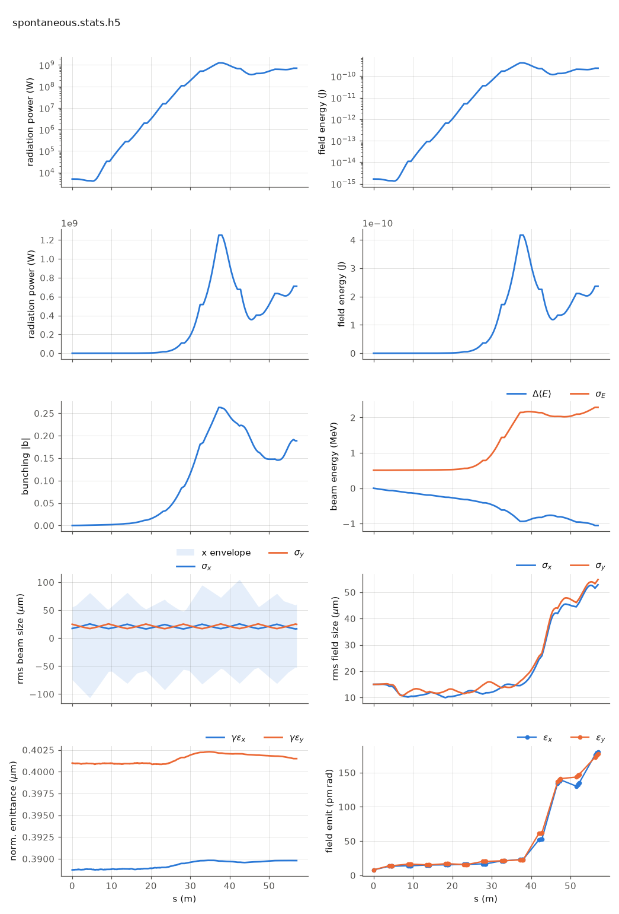

<!-- Generated by report_examples.py from examples/spontaneous/. Do not edit. -->



Everything on this page lives in and runs from `lucifer/examples/spontaneous/`.

The example runs in two commands, with Bmad only:

    ../../../production/bin/lucifer lucifer.in
    ../../../production/bin/lucifer lucifer_damping_only.in
    python ../plot_fel.py spontaneous.stats.h5

This is undulator radiation the FEL model does not account for, applied inside FEL elements under Bmad's own global switches. `bmad_com%radiation_damping_on` subtracts the classical rate from every particle. `bmad_com%radiation_fluctuations_on` adds the quantum kick, drawn once per beamlet because the quiet start cancels within a beamlet. There is no separate FEL-side switch and no separate FEL-side default. These are the same two switches Tao exposes, off unless the input turns them on ([the input reference](../../input-reference.md)).

Both decks are the `../steady_state` deck plus the switches, so that run is the control and the difference is the radiation.

The plot shows it in the beam-energy panel, where the mean falls in a straight line from the first meter. Over the first 20 m the FEL has amplified the seed to only a few MW and has extracted nothing measurable, so that slope is the radiation and nothing else. Fitting it there is the measurement:

| run | d\<E\>/ds per metre of undulator | against the analytic rate |
|---|---|---|
| `lucifer_damping_only.in` | -0.03071 m_e c^2 | 100.3% |
| `lucifer.in`, both switches | -0.03103 m_e c^2 | 101.4% |
| `../steady_state`, neither switch | -0.00008 m_e c^2 | 0.25% |

The classical rate `(2/3) r_e gamma^2 k_u^2 a_w^2` is 0.030616 m_e c^2 per metre of undulator at these parameters, and the damping run reproduces it to 0.3%. The last row is the control. With both switches off the same fit finds a quarter of a percent of that rate, which is the FEL's own start-up extraction and not radiation. Over the whole line the analytic loss is 1.47 m_e c^2 across 47.88 m of undulator. By then the FEL is extracting far more than radiation is, so the pre-gain slope is where the two can be told apart.

The harness makes the same comparison without any FEL model, tracking the wiggler with Bmad's own `runge_kutta`, and reproduces the analytic rate to 1.0e-4 ([validation](../../validation.md), the spontaneous-emission section). That check also measures what the averaged FEL mode does not do. Its field gains `2S` while the particles are kicked by `E`, so the `|S|^2` part of the field energy is created rather than taken from the beam. Genesis 1.3 Version 4 (Genesis4) carries an optional `&sponrad` module for the same reason, off by default.

Fluctuations barely move the exit numbers here, because at 1 Angstrom the quantum kick is small against the slice energy spread the beam starts with and the several times larger spread the FEL itself drives by saturation. Fluctuations are refused together with slice migration, since one draw per beamlet and a pass that regroups beamlets cannot both be right.

The run reports the split between the mode and the wide-angle emission of the point beamlets. That emission comes from macroparticles that occupy one grid point each, and no real beam radiates it ([SASE convergence](../../startup-noise.md)). At the mode peak and at the exit the power outside the split angle is a small fraction of the power inside it, so the exit power is the mode. With the filter off the same deck reports about half of its exit power as that emission. The damping and fluctuation measurements are made on the beam's energy, which the split does not touch. The measured quantities of both decks, the energy spreads and the ratios among them, are in the table below.

Each run takes about five seconds.

## Measured on this run

The runner wrote these from each run's stats file and log, and the keystone regenerates them. A float carries five significant digits.

| Quantity | `lucifer.in` | `lucifer_damping_only.in` | Unit |
|---|---|---|---|
| exit power | 5.5527e+08 | 5.5672e+08 | W |
| exit power per slice | 5.5527e+08 | 5.5672e+08 | W |
| exit pulse energy | 1.8522e-10 | 1.8570e-10 | J |
| peak power | 1.1534e+09 | 1.1543e+09 | W |
| s of the peak power | 3.8045e+01 | 3.8045e+01 | m |
| mode peak, power inside the split | 1.1510e+09 | 1.1521e+09 | W |
| s of the mode peak | 3.7680e+01 | 3.8000e+01 | m |
| exit power inside the split | 5.5181e+08 | 5.5366e+08 | W |
| exit power outside the split | 3.4624e+06 | 3.0631e+06 | W |
| outside over inside, the run's maximum | 1.9120e-03 | 1.8648e-03 |  |
| outside over inside at the exit | 6.2746e-03 | 5.5325e-03 |  |
| split angle | 2.9661e-06 | 2.9661e-06 | rad |
| gain length, the shortest e-folding length over five consecutive records | 2.1402e+00 | 2.1360e+00 | m |
| power at the first element end | 4.1206e+03 | 4.1251e+03 | W |
| power per slice at the first element end | 4.1206e+03 | 4.1251e+03 | W |
| initial bunching, mean |b| over slices | 3.9886e-17 | 3.9886e-17 |  |
| exit bunching, mean |b| over slices | 2.2699e-01 | 2.3541e-01 |  |
| exit bunching, the largest slice | 2.2699e-01 | 2.3541e-01 |  |
| bunching, the maximum along the line of the mean |b| | 2.8189e-01 | 2.8165e-01 |  |
| s of the bunching maximum | 3.8672e+01 | 3.8628e+01 | m |
| bunching at the mode peak | 2.7833e-01 | 2.7902e-01 |  |
| power of the largest slice at the bunching maximum | 1.1304e+09 | 1.1337e+09 | W |
| exit power of the largest slice | 5.5527e+08 | 5.5672e+08 | W |
| mean slice energy at the start | 5.8038e+09 | 5.8038e+09 | eV |
| mean slice energy at the exit | 5.8029e+09 | 5.8029e+09 | eV |
| mean slice energy, exit minus start | -9.3367e+05 | -9.3633e+05 | eV |
| slice energy spread at the start | 5.0879e+05 | 5.0879e+05 | eV |
| slice energy spread at the exit | 2.3323e+06 | 2.3430e+06 | eV |
| span of the slice energies at the exit, head to tail | 0.0000e+00 | 0.0000e+00 | eV |
| slices | 1 | 1 |  |
| records | 1105 | 1105 |  |
| slice spacing | 1.0000e-10 | 1.0000e-10 | m |
| macroparticles per slice | 8192 | 8192 |  |
| grid points | 256 | 256 |  |
| grid cell | 1.5690e-06 | 1.5690e-06 | m |
| grid derived by setup | no | no |  |
| FEL steps | 1068 | 1068 |  |
| source filter, mode angle | 2.9660e-06 | 2.9660e-06 | rad |
| source filter, rho angle | 2.6110e-06 | 2.6110e-06 | rad |
| source filter, ratio of the angles | 1.1400e+00 | 1.1400e+00 |  |
| source filter, edge | 2.9661e-06 | 2.9661e-06 | rad |

## The input files

The deck, its variants, and any lattice they name, as they are on disk.

### `lucifer.in`

```fortran
&fel_params
  lat_file = "../aramis.bmad"
  global%out_root = "spontaneous"
  bmad_com%radiation_damping_on = T
  bmad_com%radiation_fluctuations_on = T
/

&fel_beam_init
  beam_init%n_particle = 8192
  beam_init%bunch_charge = 1.000692285594e-15
  beam_init%sig_z = 0
  beam_init%sig_pz = 8.804506566858e-5
  beam_init%a_norm_emit = 4e-7
  beam_init%b_norm_emit = 4e-7
/

&fel_wavefront_init
  wavefront_init%lambda0 = 1e-10
  wavefront_init%seed_power = 5e3
  wavefront_init%seed_waist_size = 30e-6
  wavefront_init%grid_n_pts = 256
  wavefront_init%grid_half_width = 2e-4
/
```

### `lucifer_damping_only.in`

```fortran
&fel_params
  lat_file = "../aramis.bmad"
  global%out_root = "damping_only"
  bmad_com%radiation_damping_on = T
/

&fel_beam_init
  beam_init%n_particle = 8192
  beam_init%bunch_charge = 1.000692285594e-15
  beam_init%sig_z = 0
  beam_init%sig_pz = 8.804506566858e-5
  beam_init%a_norm_emit = 4e-7
  beam_init%b_norm_emit = 4e-7
/

&fel_wavefront_init
  wavefront_init%lambda0 = 1e-10
  wavefront_init%seed_power = 5e3
  wavefront_init%seed_waist_size = 30e-6
  wavefront_init%grid_n_pts = 256
  wavefront_init%grid_half_width = 2e-4
/
```
