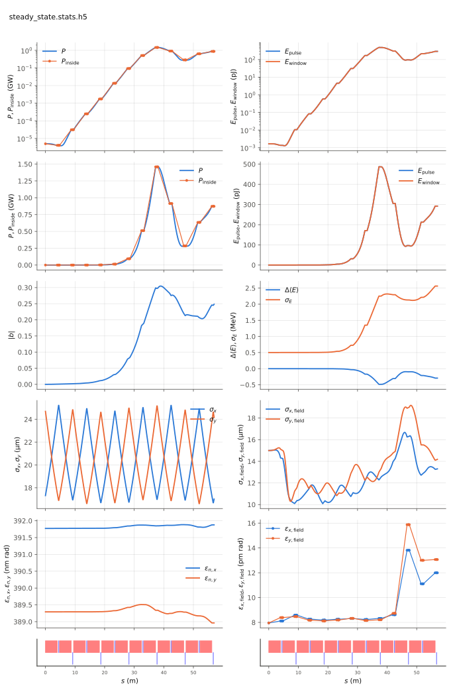

<!-- Generated by report_examples.py from examples/steady_state/. Do not edit. -->



Everything on this page lives in and runs from `examples/steady_state/`.

:::{table} The case of this example: its lattice and its beam, from the statistics file of its run. The emittance, the beam size and the Twiss functions are those of the slices at the first record, averaged over the slices by their current. They are moments of the macroparticles that were loaded, and so differ from the values of the input file by the statistics of the load.
:label: tab-case-steady-state

| quantity | value |
|---|---|
| lattice file | `examples/aramis.bmad` |
| radiation wavelength | 0.100 nm |
| beam energy | 5.80 GeV |
| current | 3.00 kA, steady state |
| normalized emittance, x and y | 0.392 and 0.390 µm |
| rms relative momentum spread of a slice | $8.6\times10^{-5}$ |
| rms beam size at the entrance, x and y | 17.3 and 24.7 µm |
| beta function at the entrance, x and y | 8.68 and 17.8 m |
| alpha function at the entrance, x and y | $-0.73$ and $1.44$ |
| undulator | helical, period 15.0 mm, rms parameter $a_w$ = 0.8485 |
| undulator segments | 12 of 3.99 m |
| quadrupoles | 12, $k_1$ from $-2$ to $2$ m$^{-2}$ |
| length of the line | 57.0 m |
| window | one slice of one wavelength |
| FEL parameter $\rho$ of the one-dimensional theory | $5.1\times10^{-4}$ |
| gain length of the one-dimensional theory | 1.34 m |
:::

The example runs in one command, with Bmad only:

    ../../build-release/bin/lucifer lucifer.toml
    python -m lucifer.plot steady_state.stats.h5

This is a seeded, single-slice FEL on the Aramis line of [`../aramis.bmad`](examples.md#ex-the-aramis-line), the lattice of the Benchmark1-SASE case of Genesis4: twelve helical undulator segments of 3.99 m with a period of 15 mm in 6 FODO cells, 57 m in all, resonant at 0.1 nm. A slice of a 5.80 GeV beam with a current of 3.0 kA, normalized emittances of 0.4 µm and an rms relative energy spread of 8.8e-5 is tracked through it with a 5 kW Gaussian seed at its waist. Nothing external is read. The program generates the quiet-start beam and the seed field from the namelist, and the lattice supplies everything else.

`sig_z = 0` makes the run steady state. The whole charge sits in the one slice window, so the current is `I = Q*c/slice_spacing`, and `bunch_charge` in the input file encodes 3 kA exactly. The current is always derived this way and never entered ([the input reference](../../input-reference.md)).

On this input the quiet start is exact to the initial bunching in the table, so the FEL grows from the seed and not from sampling noise. The power grows exponentially from the seed, saturates past the middle of the line, and falls back at the exit as particles rotate in the bucket. The gain length, the peak power with its position, and the exit power are in the table below on the example's page. The beam sizes start on the lattice's matched values, since `init_beam_distribution` generates the bunch from the Twiss in the lattice's `beginning` statement.

The two `dump_*_at` lines write the beam and the field at the third undulator, `steady_state-at9-UND.beam.h5` and `-at9-UND.wf.h5`, both openPMD. `at9` is the element index the locator resolved. Mid-run dumps are how a run is handed to another program or restarted from the middle, and a single slice keeps them under 1.5 MB here. The same two lines on the `../sase` window write about a hundred megabytes.

Read [reading an output file](../../reading-output.md) for the stats file and the ten plot panels. The run reports the split between the mode and the wide-angle emission of the point beamlets. That emission comes from macroparticles that occupy one grid point each, and no real beam radiates it ([SASE convergence](../../startup-noise.md)). The table gives the power outside the split angle over the power inside it, at the mode peak and at the exit. Both ratios are well under a percent, so the exit power is the mode. With the filter off the same input file reports more power at the exit and at the peak, and nearly half of that exit power is this emission.

The run takes about five seconds.

## Measured on this run

The runner wrote these from each run's stats file and log, and the keystone regenerates them. A float carries five significant digits.

| Quantity | `lucifer.toml` | Unit |
|---|---|---|
| exit power | 8.7586e+08 | W |
| exit power per slice | 8.7586e+08 | W |
| exit window energy | 2.9215e-10 | J |
| exit pulse energy, the window's and the light slipped out of it | 2.9215e-10 | J |
| peak power | 1.4608e+09 | W |
| s of the peak power | 3.7240e+01 | m |
| mode peak, power inside the split | 1.4598e+09 | W |
| s of the mode peak | 3.7240e+01 | m |
| exit power inside the split | 8.7274e+08 | W |
| exit power outside the split | 3.1208e+06 | W |
| outside over inside, the run's maximum | 7.1586e-04 |  |
| outside over inside at the exit | 3.5759e-03 |  |
| split angle | 2.9849e-06 | rad |
| gain length, the shortest e-folding length over five consecutive records | 2.1227e+00 | m |
| power at the first element end | 4.0672e+03 | W |
| power per slice at the first element end | 4.0672e+03 | W |
| initial bunching, mean |b| over slices | 3.9308e-17 |  |
| exit bunching, mean |b| over slices | 2.4836e-01 |  |
| exit bunching, the largest slice | 2.4836e-01 |  |
| bunching, the maximum along the line of the mean |b| | 3.0472e-01 |  |
| s of the bunching maximum | 3.8941e+01 | m |
| bunching at the mode peak | 2.9896e-01 |  |
| power of the largest slice at the bunching maximum | 1.4035e+09 | W |
| exit power of the largest slice | 8.7586e+08 | W |
| mean slice energy at the start | 5.8038e+09 | eV |
| mean slice energy at the exit | 5.8035e+09 | eV |
| mean slice energy, exit minus start | -2.9250e+05 | eV |
| slice energy spread at the start | 5.0137e+05 | eV |
| slice energy spread at the exit | 2.5639e+06 | eV |
| span of the slice energies at the exit, head to tail | 0.0000e+00 | eV |
| slices | 1 |  |
| records | 1105 |  |
| slice spacing | 1.0000e-10 | m |
| macroparticles per slice | 8192 |  |
| grid points | 256 |  |
| grid cell | 1.5686e-06 | m |
| grid derived by setup | no |  |
| FEL steps | 1068 |  |
| source filter, mode angle | 2.9849e-06 | rad |
| source filter, rho angle | 2.6168e-06 | rad |
| source filter, ratio of the angles | 1.1407e+00 |  |
| source filter, edge | 2.9849e-06 | rad |
| beamlet size | 4 |  |
| beamlet size derived by setup | yes |  |
| macroparticles per slice derived by setup | no |  |

## The input files

The input file, its variants, and any lattice they name, as they are on disk.

### `lucifer.toml`

```toml
lattice = "../aramis.bmad"

[run]
out_root = "steady_state"
dump_beam_at = "UND##3"
dump_field_at = "UND##3"

[beam]
n_particle = 8192
bunch_charge = 1.000692285594e-15
sig_z = 0
sig_pz = 8.804506566858e-5
a_norm_emit = 4e-7
b_norm_emit = 4e-7

[field]
lambda0 = 1e-10
grid_n_pts = 256
grid_half_width = 2e-4
seed_power = 5e3
seed_waist_size = 30e-6
```
