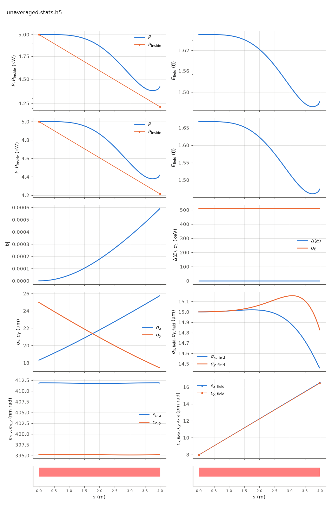

<!-- Generated by report_examples.py from examples/unaveraged/. Do not edit. -->



Everything on this page lives in and runs from `examples/unaveraged/`.

The example runs in two commands, with Bmad only:

    ../../../production/bin/lucifer lucifer.in
    ../../../production/bin/lucifer lucifer_averaged.in
    python ../plot_fel.py unaveraged.stats.h5

This is one seeded steady-state segment tracked with no period averaging and no resonance approximation (the manual's [unaveraged-mode section](../../fel-physics.md)). The particles ride the real helical field, quiver and all, at 20 integration substeps per period with sin^2 entry and exit ramps, and the radiation is a co-evolving kick. Nothing in this path knows the coupling factor `fc`: the energy exchange is what the Lorentz force does.

The mode is `seg1.bmad`'s own `fel_method`, `unaveraged`. The substep count and the ramp length are global switches, `global%unaveraged_steps_per_period` and `global%unaveraged_ramp_periods`, at their defaults here. `lucifer_averaged.in` runs the identical configuration through the averaged default, with a lattice that calls the same file and overrides that one attribute.

On this input the two gain curves agree in ln P at the segment exit to under one part in a thousand, and the table below carries both exit powers. Those are two independent formulations of the same physics, sharing no approximation, and the agreement is what pins the averaged mode's coupling factor. `lucifer_averaged.in` states `global%source_filter = F`, since the unaveraged mode builds no source to filter and the two must compare like for like. The harness measures the factor itself to about 6e-4 with dedicated probes ([validation](../../validation.md)).

The run also writes `unaveraged.ledger.txt`: beam energy relative to the reference and window field energy per record, whose sum is conserved. The harness checks the closure at 1e-4 of the turnover under a strong-exchange probe.

One segment sits in the lethargy regime, so the plot shows the two curves overlaid rather than a gain curve. The seed diffracts and exponential growth is only beginning at the exit. For the same comparison over a full line, with one segment unaveraged among eleven averaged ones, see `../mixed_line`.

The run takes about five seconds, against under a second for the averaged twin.

## Measured on this run

The runner wrote these from each run's stats file and log, and the keystone regenerates them. A float carries five significant digits.

| Quantity | `lucifer.in` | `lucifer_averaged.in` | Unit |
|---|---|---|---|
| exit power | 4.4185e+03 | 4.4159e+03 | W |
| exit power per slice | 4.4185e+03 | 4.4159e+03 | W |
| exit pulse energy | 1.4738e-15 | 1.4730e-15 | J |
| peak power | 5.0000e+03 | 5.0000e+03 | W |
| s of the peak power | 2.6899e-01 | 1.3449e-01 | m |
| mode peak, power inside the split | 5.0000e+03 | 5.0000e+03 | W |
| s of the mode peak | 0.0000e+00 | 0.0000e+00 | m |
| exit power inside the split | 4.2156e+03 | 4.1988e+03 | W |
| exit power outside the split | 2.0288e+02 | 2.1709e+02 | W |
| outside over inside, the run's maximum | 2.2985e-07 | 2.2985e-07 |  |
| outside over inside at the exit | 4.8127e-02 | 5.1702e-02 |  |
| split angle | 2.9077e-06 | 2.9077e-06 | rad |
| power at the first element end | 4.4185e+03 | 4.4159e+03 | W |
| power per slice at the first element end | 4.4185e+03 | 4.4159e+03 | W |
| initial bunching, mean |b| over slices | 3.6362e-17 | 3.6362e-17 |  |
| exit bunching, mean |b| over slices | 5.9004e-04 | 5.9416e-04 |  |
| exit bunching, the largest slice | 5.9004e-04 | 5.9416e-04 |  |
| bunching, the maximum along the line of the mean |b| | 5.9004e-04 | 5.9416e-04 |  |
| s of the bunching maximum | 3.9900e+00 | 3.9900e+00 | m |
| bunching at the mode peak | 3.6362e-17 | 3.6362e-17 |  |
| power of the largest slice at the bunching maximum | 4.4185e+03 | 4.4159e+03 | W |
| exit power of the largest slice | 4.4185e+03 | 4.4159e+03 | W |
| mean slice energy at the start | 5.8038e+09 | 5.8038e+09 | eV |
| mean slice energy at the exit | 5.8038e+09 | 5.8038e+09 | eV |
| mean slice energy, exit minus start | 1.9411e-01 | 1.9024e-01 | eV |
| slice energy spread at the start | 5.0869e+05 | 5.0869e+05 | eV |
| slice energy spread at the exit | 5.0871e+05 | 5.0871e+05 | eV |
| span of the slice energies at the exit, head to tail | 0.0000e+00 | 0.0000e+00 | eV |
| slices | 1 | 1 |  |
| records | 90 | 90 |  |
| slice spacing | 1.0000e-10 | 1.0000e-10 | m |
| macroparticles per slice | 2048 | 2048 |  |
| grid points | 128 | 128 |  |
| grid cell | 3.1500e-06 | 3.1500e-06 | m |
| grid derived by setup | no | no |  |
| FEL steps | 5340 | 89 |  |
| source filter, mode angle | 2.9080e-06 |  | rad |
| source filter, rho angle | 2.5940e-06 |  | rad |
| source filter, ratio of the angles | 1.1200e+00 |  |  |
| source filter, edge | 2.9077e-06 |  | rad |

## The input files

The deck, its variants, and any lattice they name, as they are on disk.

### `lucifer.in`

```fortran
&fel_params
  lat_file = "seg1.bmad"
  global%out_root = "unaveraged"
  global%write_diag = T
/

&fel_beam_init
  beam_init%n_particle = 2048
  beam_init%bunch_charge = 1.000692285594e-15
  beam_init%sig_z = 0
  beam_init%sig_pz = 8.804506566858e-5
  beam_init%a_norm_emit = 4e-7
  beam_init%b_norm_emit = 4e-7
/

&fel_wavefront_init
  wavefront_init%lambda0 = 1e-10

  wavefront_init%seed_power = 5e3
  wavefront_init%seed_waist_size = 30e-6
  wavefront_init%grid_n_pts = 128
  wavefront_init%grid_half_width = 2e-4
/
```

### `lucifer_averaged.in`

```fortran
&fel_params
  lat_file = "seg1_averaged.bmad"
  global%out_root = "averaged"
  global%source_filter = F   ! The averaged and unaveraged twins compare like for like.
  global%write_diag = T
/

&fel_beam_init
  beam_init%n_particle = 2048
  beam_init%bunch_charge = 1.000692285594e-15
  beam_init%sig_z = 0
  beam_init%sig_pz = 8.804506566858e-5
  beam_init%a_norm_emit = 4e-7
  beam_init%b_norm_emit = 4e-7
/

&fel_wavefront_init
  wavefront_init%lambda0 = 1e-10

  wavefront_init%seed_power = 5e3
  wavefront_init%seed_waist_size = 30e-6
  wavefront_init%grid_n_pts = 128
  wavefront_init%grid_half_width = 2e-4
/
```

### `seg1.bmad`

```fortran
! One undulator segment of the benchmark line, ../aramis.bmad's UND and nothing else:
! 3.99 m and 266 periods of helical undulator, aw = 0.85 rms, resonant at 1 Angstrom at
! 5.8 GeV. The element's fel_method is unaveraged, which is what selects the mode, and
! the averaged twin sets it back to averaged.

no_digested
parameter[geometry] = open
parameter[particle] = electron
parameter[e_tot] = 11357.82 * m_electron

beginning[beta_a] = 8.53711
beginning[alpha_a] = -0.703306
beginning[beta_b] = 17.3899
beginning[alpha_b] = 1.40348

UND: wiggler, l = 3.99, l_period = 0.015, field_calc = helical_model, &
     b_max = 0.84853 * (twopi / 0.015) * m_electron / c_light, &
     fel_method = unaveraged, ds_step = 0.045

SEG1: line = (UND)

use, SEG1
```

### `seg1_averaged.bmad`

```fortran
! The averaged twin of seg1.bmad: the same element with fel_method = averaged, which is
! the wiggle-averaged model on Bmad's own periodic-wiggler maps.
call, file = seg1.bmad
UND[FEL_METHOD] = averaged
```
