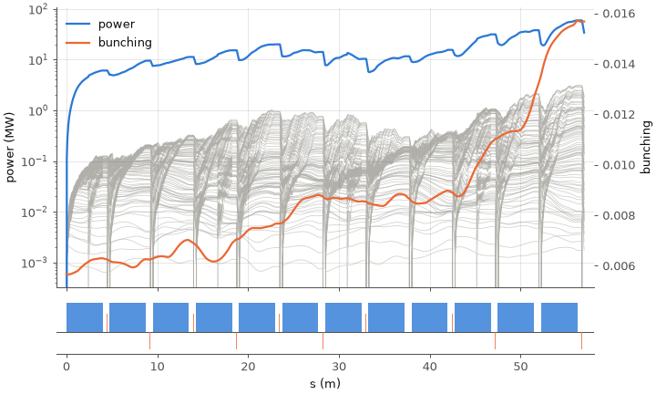
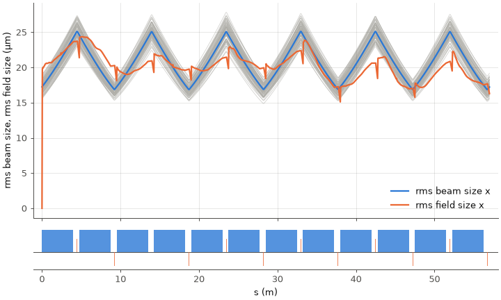
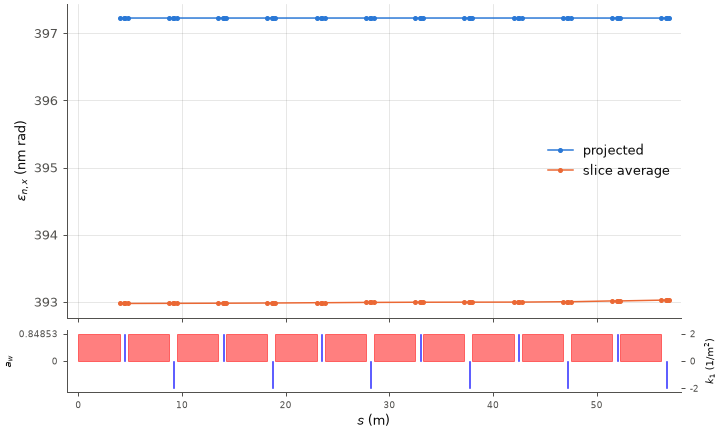
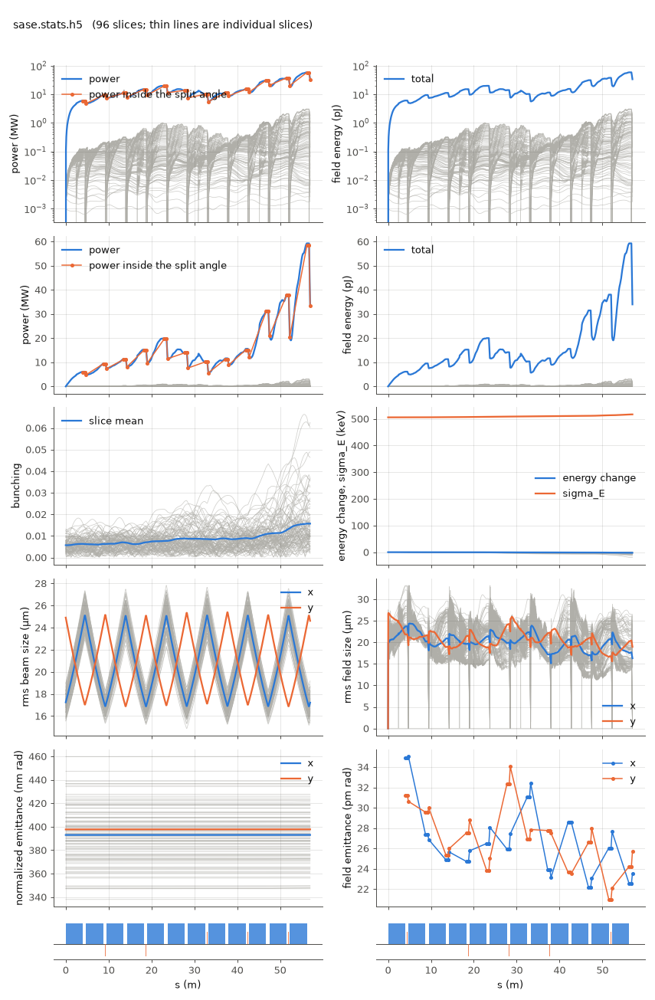

(python-package)=
# Python

The package `lucifer` under `python/` is the input file as typed Python, a runner for the program, and the readers of the files a run writes. The program is the source of truth. The package holds no default the program does not, writes nothing but the TOML the program reads, and checks nothing the program refuses itself, so a value outside its bounds is refused by the program with the program's message. Every class and function is in the [Python reference](generated/python-api.md), generated from the package's own docstrings. The [notebooks](notebooks/quickstart.ipynb) show the package in use, a step to a cell with each output beneath it, executed with the examples so their outputs are real. Every example on this page is code a test runs: the ones that need no executable under pytest in `python/tests/test_page.py`, and the ones that run the program in `tests/scripts/check_program.py`, which the keystone runs.

## Installing

```
pip install -e "python[plot]"
```

The package needs Python 3.11 or later. The input file, the runner and the schema use the standard library alone, and the readers need `numpy` and `h5py`. The plots need the extra `plot`, which is openpmd-beamphysics and brings matplotlib, so `pip install -e python` installs everything else. In this repository the package is installed into the `bmad-fel-validate` environment with that environment's own pip and `--no-deps`, since the environment's file states every dependency.

(python-object)=
## The Lucifer object

`lucifer.Lucifer` is one object for a run: its input file, the directory it runs in, and its output, with plotting and archiving on it, so one import serves and tab completion shows the rest. It carries the names and meanings of lume-base's `CommandWrapper`, the interface LUME-Genesis's `Genesis4` and the other LUME codes share, without depending on lume-base: `input`, `output`, `initial_particles`, `workdir`, `path`, `configure()`, `run()`, `load_output()`, `fingerprint()`, `copy()`, `reset()`, `archive()`, `from_archive()`, `plot()` and the rest. The MPI names and `from_yaml` are left out, since the program threads with OpenMP and its input is TOML.

% example: object
```python
from lucifer import Lucifer

L = Lucifer("lucifer.toml", threads=4)
L.input.beam.n_particle = 1024
L.run()
L.plot(y="field/total/power", yscale="log")
```

`Lucifer` takes an `Input`, the path of an input file or TOML text. A run happens in a temporary directory inside `workdir`, or in `workdir` itself with `use_temp_dir=False`, or in the input file's own directory when neither is given. The input file is written there with the lattice and every file it names as absolute paths resolved from the directory the input came from, so nothing is copied. `initial_particles` takes an openPMD-beamphysics `ParticleGroup`, written into the run's directory and named by `beam.position_file`. In Jupyter the object, its `input`, its `output` and the output's `stats` each show a table of what they hold.

% example: archive
```python
L.archive("page-run.h5")
R = Lucifer.from_archive("page-run.h5")
R.input.beam.n_particle
```

The archive of a run is its stats file, which holds the input file the run read in `meta/input_echo` and every output array, so `archive()` copies it and `from_archive()` rebuilds the object from it. The restored input is the one the run read, with every value the program derived written out, so its `fingerprint()` differs from an input that left those values to the program. `archive(path, include_dumps=True)` also copies the run's particle and field dumps into a directory beside the archive named for its stem, `run/` for `run.h5`, where `from_archive()` finds them.

(python-dumps)=
### The dumps

A run's particle and field dumps stay on disk until they are asked for, since a run's dumps are often gigabytes. `output.particle_files` and `output.field_files` map a key to the file, from the list of files the run's footer prints: `final` and `initial`, `at<n>-<element>` for a dump at the end of element n, a frame by its record number, and `pulse` for the fields, with `escaped` beside it when `run.write_escaped` kept it, and `-h<h>` for a harmonic. Both polarizations are components of one file. `output.particles` and `output.fields` map the same keys to openPMD-beamphysics objects, each read on first access and kept, a `ParticleGroup` for a beam dump and a `Wavefront` for a field dump:

% example: dumps
```python
L.output.particle_files              # {'final': PosixPath('.../page-final.beam.h5')}
L.output.particles                   # every dump, its file size, and whether it is loaded
P = L.output.particles["final"]      # a ParticleGroup, read now and kept
W = L.output.fields["final"]         # a Wavefront
one = L.output.load_particles_by_key("final", slice=0)   # one slice, from its patch alone
```

Shown, the mapping lists every key with its file size and whether it is loaded, and reads no file. `load_particles()` and `load_fields()` read every dump of the kind, and `load_particles_by_key()` and `load_field_by_key()` read one, as LUME-Genesis names them. `run(load_particles=True, load_fields=True)` reads them all when the run ends. A `slice` argument reads one slice of a beam dump from its particle patch alone, the i-th from 0 in the order the file stores them, which is the order `lucifer.beam.read_slices` returns. A run in a temporary directory keeps the directory while its output is held, so the files outlive the `Lucifer` object that ran them. openPMD-beamphysics is imported only when a dump is read.

(python-schema)=
## The schema the package carries

`python/lucifer/schema.json` is the schema the program writes with `lucifer --schema`, as JSON Schema. It is the one committed copy: an installed package needs the schema beside its code, and a second copy would need a check that the two agree. The keystone writes it from the production executable and requires no difference from the committed file, so the keys, the types, the defaults and the bounds here are the program's own. An editor that reads JSON Schema validates an input file against it as it is typed.

% example: schema
```python
from lucifer import schema

schema.path()                                   # schema.json, as the program wrote it
schema.keys()["run"]["ran_seed"]["default"]     # 12345
```

(python-input)=
## The input file as Python

`lucifer.Input` is the input file: the lattice and one object per table, `Run`, `Window`, `Beam` with `Resample`, `Field`, `Wake`, `SpaceCharge` and `Bmad`. These are dataclasses in `python/lucifer/models.py`, generated from the schema by `python -m lucifer.generate`, and the keystone regenerates the file and requires no difference. Every field carries the program's type and default and a docstring of the key's meaning, its unit and its bounds, so an editor completes the keys and shows what each means. [](input-reference.md) is the same table for a reader.

What the models hold is data. They check no bound and derive no default, since the program does both: a field the program derives at setup, such as `beam.n_particle` or `field.grid_n_pts`, holds the program's 0, which means derive it. A key the input file does not have is Python's own error, a `TypeError` from the constructor or a `KeyError` from the dotted access.

% example: input
```python
from lucifer import Input

inp = Input(lattice="aramis.bmad")
inp.beam.n_particle = 4096
inp["run.out_root"] = "s7"          # a key by its dotted name
inp.write("s7.toml")                # the TOML the program reads
same = Input.read("s7.toml")
```

An input file is written as the TOML the program reads. `toml()` and `write()` write the lattice and the keys set away from their defaults, which keeps an input file to what it means, and with `explicit=True` they write every key. `items()` lists the keys set away from their defaults by their dotted names.

% example: explicit
```python
inp.write("s7-all.toml", explicit=True)   # every key, the defaults written out
for key, value in inp.items():            # the keys set away from their defaults
    print(key, "=", value)
```

`Input.read()` and `Input.loads()` read an input file back through `tomllib`. Since every run echoes the input file it read into `meta/input_echo` of its stats file, with the defaults written out, an input file is also read back from any run, which is how the run example below checks what it ran.

(python-run)=
## Running the program

`lucifer.run` runs the program on an `Input`, written into the run's directory as `name`, or on the path of an input file. The executable is the `exe` argument, else `LUCIFER_EXE`, else `lucifer` on `PATH`, and `threads` sets `OMP_NUM_THREADS`. It returns a `Result` with the exit code, the output the program printed, `out_root` as the program's header states it, the stats file's path, and the files the footer says the run wrote, and `result.stats` opens the stats file through the reader.

% example: run
```python
from lucifer import Input, run

inp = Input.read("lucifer.toml")
inp["beam.n_particle"] = 1024
inp.run.out_root = "n1024"
result = run(inp, threads=4, name="n1024.toml")

with result.stats as st:
    power = st["field/total/power"]            # (nz, ns) W, record by slice
    echo = Input.loads(st.meta["input_echo"])  # the input file the run read
```

The overrides of the command line pass through, each `table.key=value` as [](user-guide.md) describes them under Running, so a scan over one key is a loop over one input file:

% example: scan
```python
for n in (512, 1024, 2048):
    run("lucifer.toml", threads=4, overrides=[f"beam.n_particle={n}", f"run.out_root=scan{n}"])
```

A nonzero exit raises `LuciferError` carrying the program's error text, so a refusal reads as the program wrote it:

% example: refusal
```python
from lucifer import LuciferError

try:
    run("lucifer.toml", overrides=["beam.n_particle=-5"])
except LuciferError as err:
    print(err.message)
```

(python-readers)=
## Reading the output

`lucifer.stats` is the one reader of the stats file that everything in the tree uses. Because the file describes itself, the reader hard-codes no dataset names, so a file that grows a polarization or a harmonic needs no change in it. What each group holds is [](reading-output.md).

% example: stats
```python
from lucifer.stats import read_stats

with read_stats("n1024.stats.h5") as st:
    st.s                          # (nz,) path length, a variable on the record axis
    st.record                     # (nz,) the record axis itself
    st["beam/slice/current"]      # (nz, ns) amperes, as the file states them
    st.coord("plane")             # ('x', 'y', 'z')
    st.dim_coords("beam/slice/sigma")   # the coordinate of each dimension, in order
    st.units["beam/slice/t"]      # 's'
    st.run["p0c"]                 # what the run produced
    st.params["run"]["ran_seed"]  # what the user set
    st.ele_name                   # (nz,) element name per record, gathered through ix_ele
```

`lucifer.beam` reads a particle dump into per-slice arrays, from openPMD, the format the program writes, or from a Genesis4 `.par.h5`. An openPMD dump does not carry the wavelength, which belongs to the run and not to the beam, so the caller states it, here from the input file the run read:

% example: beam
```python
from lucifer.beam import read_slices

slices = read_slices("n1024-final.beam.h5", wavelength=inp.field.lambda0)
slices[0]["n"], slices[0]["x"]    # the first slice's particle count and x [m]
```

`lucifer.field` reads the whole pulse at the exit, `<out_root>-pulse.wf.h5`, which a run whose window let light out keeps: the window's planes and then the light that slipped out of the window, each banked plane drifted to the exit, with where each left and its moments when it left. The pulse is an openPMD wavefront file like every field dump, so openpmd-beamphysics reads it whole, and `read_pulse` adds the two arrays of its `lucifer/pulse` group. With `run.write_escaped` the run also keeps the bank the pulse was built from, `<out_root>-escaped.wf.h5`, each plane as it was when it left, which `read_escaped` reads with the same two arrays. A time-dependent run of the same input lets light out:

% example: field
```python
from lucifer.field import read_pulse

pulse = read_pulse("td-pulse.wf.h5")   # the whole pulse at the exit
pulse.wavefront.Ex.shape               # (nx, ny, nz), the window's planes and then the banked
pulse.z_transmit                       # (n,) where along the lattice each banked plane left [m]
pulse.params[:, 20]                    # each banked plane's energy when it left [J]
```

`tests/scripts/validate_bmad_stats.py` is the format's conformance checker. It knows no program and no extension, needs only numpy and h5py, and exits nonzero on any failure:

```
python3 validate_bmad_stats.py run.stats.h5
```

Units in these files are documentation, never a factor to apply. The values are already SI and eV. That is the opposite of openPMD's `unitSI`, which is why the two never appear in one file.

(python-plot)=
## Plotting

`lucifer.plot.plot` draws curves of a stats file against `s`, with the lattice layout under them, in the form of LUME-Genesis's `plot`. It takes the file or its path, the curves for the left axis as `y` and for the right as `y2`, their scales, their limits in the file's units, and `include_layout`, `include_legend` and `return_figure`. Each axis is labeled by the curves' symbols and their `@unit`, scaled by the SI prefix that openpmd-beamphysics chooses for the values, and a unit with a power or a quotient keeps its stated form. A curve openpmd-beamphysics has a name for takes that name's symbol from `beamphysics.labels.texlabel`, as in LUME-Genesis, so the beam sizes read $\sigma_x$ and $\sigma_y$. Power, bunching and the field's sizes and emittances take symbols of their own, and any other curve keeps the file's `@long_name`, as every curve does with `tex=False`. `Stats.plot` and `Result.plot` call it with their own file. The figures here are drawn from the run of the [SASE example](generated/examples/sase.md), 96 slices through twelve undulator segments, by the code shown above each one, and `examples/run_examples.sh` redraws them whenever it runs the examples.

% example: plot-power
```python
from lucifer.plot import plot

plot("sase.stats.h5", y="field/total/power", y2="beam/slice/bunching", yscale="log")
```



The window's total power grows segment by segment along the line, with a thin gray line for each slice under it, and the slice-mean bunching rises on the right axis. A curve on the record and slice axes is drawn this way, the window total bold for watts, joules and coulombs and the slice mean bold for the rest. The layout under the axes comes from the file's `lattice` group, in LUME-Genesis's colors: each FEL element's `aw` is a red box on the left axis, and each quadrupole's `k1` a blue box on the right, up or down by its sign. Both are drawn at their true lengths, so a quadrupole of 0.08 m on this 57 m line is a line one pixel wide, edged so that it stays visible. No lattice is built in Python.

A curve is a dataset path, a path with components named in brackets by the labels of the dataset's own axes, `coords/plane`, `coords/bmad` or `coords/wavefront`, or one of the derived quantities the module lists with their formulas, the rms sizes, the normalized emittances with the dispersion removed, the energy change and the field emittances. Curves of one unit share an axis, and the legend names each.

% example: plot-sizes
```python
plot("sase.stats.h5", y=["beam_size_x", "field_size_x"])
```



The beam's size follows the FODO lattice, and the field's is pulled onto it as the gain grows, which is gain guiding. Only the first curve of an axis draws its slices, so the two stay legible.

% example: plot-components
```python
plot("sase.stats.h5", y=["beam/bunch/twiss/norm_emit[x]", "beam/slice_twiss/twiss/norm_emit[x]"],
     labels=["projected", "slice average"])
```



A dataset on the element-end axis is drawn as points at the element ends. Here the `x` in brackets picks the plane from `coords/plane`, and `labels` names the curves in place of the file's names: the projected emittance stands a little above the slice average, by the spread of the slice centroids. A dataset the file does not have is refused with the datasets its group does have, and a component its axes do not label with the labels they do have.

`lucifer.plot.summary` is the standard figure of a run: radiation power and field energy on log and linear scales with the power inside the split angle, the whole pulse's energy drawn over the window's, bunching, the energy change and spread, the rms beam and field sizes, the beam's normalized and the field's emittances, a panel per polarization when the run carries two and per harmonic when it carries harmonics, and a layout under each column. Each panel is one call of `plot`, and the example pages show this figure for every example.

% example: summary
```python
from lucifer.plot import summary

summary("sase.stats.h5")
```



The same figure from the command line, by default to `<out_root>.png` in the current directory:

```
python -m lucifer.plot run.stats.h5 -o run.png
```

(python-flat)=
## Flat text

`lucifer.flat` turns flat `key = value` text, one key a line, into an input file. A key is written bare, `n_particle = 2048`, and routed into its table by name, or dotted, `run.out_root = 's7'`. The check scripts and the benchmark write their input files this way, so a template is a few lines of text and a variant is a string replacement, and `python -m lucifer.flat <flat file> <toml file>` converts from the command line, with `-` for standard input or output.

% example: flat
```python
from lucifer.flat import to_toml

text = to_toml("lattice = 'aramis.bmad'\nn_particle = 2048\nrun.out_root = 's7'\n")
```
