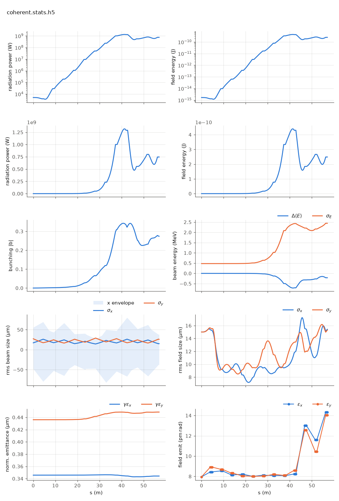

<!-- Generated by report_examples.py from examples/coherent_source/. Do not edit. -->



Everything on this page lives in and runs from `lucifer/examples/coherent_source/`.

The example runs in three commands, with Bmad only:

    ../../../production/bin/lucifer lucifer.in
    ../../../production/bin/lucifer lucifer_low_m.in
    ../../../production/bin/lucifer lucifer_reference.in
    python ../plot_fel.py coherent.stats.h5

A run whose beam is transversely Gaussian (an idealized machine, a parameter scan, a seeded amplifier study) can trade the per-particle source deposit for Tanaka's coherent retrieval, `global%source_model = "coherent"` (PRAB 27, 030703 (2024), the manual's coherent-source section). It then converges at one to two orders of magnitude fewer macroparticles. With few particles the per-cell source is spiky, and that sampling noise always overestimates the gain. The coherent source carries the slice's exact bunching phasor on a fitted Gaussian instead, so the artifact never enters.

Three runs of the same seeded steady-state case (the full Aramis line, 5.2 decades of gain, ../steady_state's configuration) are compared:

| run | source, particles/slice | exit power | vs reference | wall (12 threads) |
|---|---|---|---|---|
| `lucifer_reference.in` | deposit, 8192 | 7.93e+08 W | -- | 5 s |
| `lucifer_low_m.in` | deposit, 512 | 1.11e+09 W | 1.39x high (ln +0.33) | 3 s |
| `lucifer.in` | coherent, 512 | 7.46e+08 W | ln -0.061 | 3 s |

The middle row is the artifact the coherent source removes, and the source filter, on by default, removes most of it on its own. Cutting particles without the coherent source multiplies the predicted power by 1.39 on this case, where with the filter off it multiplied it by 7.6. The run's own convergence report puts the power outside the split angle at 1.9 percent of the power inside it on that row and 0.2 percent on the reference row. The coherent source builds no transformed source for the filter to act on, so the filter turns itself off for that run and says so. Its own ratio at the exit is 5.0 percent ([the convergence section](../../fel-physics.md#sec-convergence)). The power the middle row adds is the wide-angle emission of 64 beamlets. The coherent source does not have it, since it never puts a macroparticle on a grid point. The last row is the same particle count giving the converged answer. Per-slice cost dominates a time-dependent run, where the same particle reduction pays in proportion.

The refusals are part of the feature (the manual's coherent-source section). A per-slice Gaussianity test is sized against its own sampling significance, and a profile with real structure is refused. An offset, mismatched or tilted Gaussian beam passes, since the source centers and tilts with the beam's phasor-weighted moments. Harmonic fields, two live polarizations and the unaveraged mode are refused in v1. A dark start is refused, since the coherent model drops the spontaneous, spatially incoherent emission that SASE grows from, and its startup comes out about 175x low. Seed the field, as here, or use the default deposit.

Plot any run with ../plot_fel.py <root>.stats.h5.

## The input files

The deck, its variants, and any lattice they name, as they are on disk.

### `lucifer.in`

```fortran
&fel_params
  lat_file = "../aramis.bmad"
  global%out_root = "coherent"
  global%source_model = "coherent"
/

&fel_beam_init
  beam_init%n_particle = 512
  beam_init%bunch_charge = 1.000692285594e-15
  beam_init%sig_z = 0
  beam_init%sig_pz = 8.804506566858e-5
  beam_init%a_norm_emit = 4e-7
  beam_init%b_norm_emit = 4e-7
/

&fel_wavefront_init
  wavefront_init%lambda0 = 1e-10

  wavefront_init%seed_power = 5e3
  wavefront_init%seed_waist_size = 30e-6
  wavefront_init%grid_n_pts = 256
  wavefront_init%grid_half_width = 2e-4
/
```

### `lucifer_low_m.in`

```fortran
&fel_params
  lat_file = "../aramis.bmad"
  global%out_root = "low_m"
/

&fel_beam_init
  beam_init%n_particle = 512
  beam_init%bunch_charge = 1.000692285594e-15
  beam_init%sig_z = 0
  beam_init%sig_pz = 8.804506566858e-5
  beam_init%a_norm_emit = 4e-7
  beam_init%b_norm_emit = 4e-7
/

&fel_wavefront_init
  wavefront_init%lambda0 = 1e-10

  wavefront_init%seed_power = 5e3
  wavefront_init%seed_waist_size = 30e-6
  wavefront_init%grid_n_pts = 256
  wavefront_init%grid_half_width = 2e-4
/
```

### `lucifer_reference.in`

```fortran
&fel_params
  lat_file = "../aramis.bmad"
  global%out_root = "reference"
/

&fel_beam_init
  beam_init%n_particle = 8192
  beam_init%bunch_charge = 1.000692285594e-15
  beam_init%sig_z = 0
  beam_init%sig_pz = 8.804506566858e-5
  beam_init%a_norm_emit = 4e-7
  beam_init%b_norm_emit = 4e-7
/

&fel_wavefront_init
  wavefront_init%lambda0 = 1e-10

  wavefront_init%seed_power = 5e3
  wavefront_init%seed_waist_size = 30e-6
  wavefront_init%grid_n_pts = 256
  wavefront_init%grid_half_width = 2e-4
/
```
