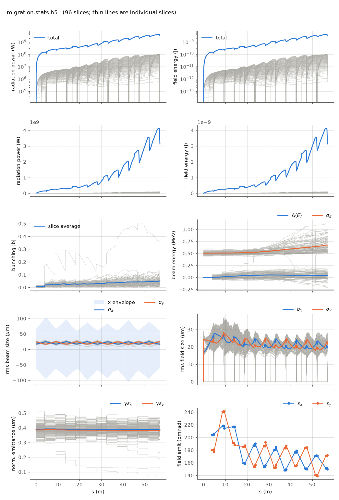

<!-- Generated by report_examples.py from examples/migration/. Do not edit. -->



Everything on this page lives in and runs from `lucifer/examples/migration/`.

The example runs in two commands, with Bmad only:

    ../../../production/bin/lucifer lucifer.in
    ../../../production/bin/lucifer lucifer_no_migrate.in
    python ../plot_fel.py migration.stats.h5

A particle's ponderomotive phase drifts, and once it leaves the slice window the particle belongs to a neighboring slice. `global%migrate = T` moves it there. This run is the `../sase` configuration at 1024 particles per slice with migration on, and `lucifer_no_migrate.in` is the same run with it off.

No artificial driver is needed to make this happen. The phase advance a particle accumulates depends on its energy and on its betatron angles, both of which vary across the beam, so a real beam in a real line migrates on its own. Adding `../sase_wake`'s chamber block to this deck raises both the moves and the dropped charge. A wake that costs the tail slices 121 keV/m and the head slices 1.9 keV/m (`../sase_wake`) is a systematic phase walk on top of the beam's own spread.

On this input the run moves particles between slices at 48 element ends and drops a small fraction of the beam's 2.88e-13 C off the window ends. `migration.migration.txt` carries the totals. The measured quantities are in the table below, the exit power and the exit bunching with migration on and off among them.

The exit powers are those of this input's grid and particle count. The power of an unseeded run depends on both ([SASE convergence](../../startup-noise.md)). Each run is also one SASE realization on a 96-slice window. Over four seeds the ratio of the two exit powers falls on either side of one, so the exit power of a single pair does not measure what migration is worth. The exit bunching is the higher with migration on in every one of those seeds. The bunching is a mean over 96 slices where the exit power follows the largest spike, which is why one of the two separates the runs and the other is swamped.

`migration.migration.txt` carries one row per event: the s position, the count, the charge dropped, the phasor deviation, and the smallest phase distance any particle at that event had to a slice boundary. The totals are at the end. The rows are what a plot of migration would be drawn from.

The per-slice current shows the difference most directly. With `migrate = F` it cannot change. All 96 slices sit at exactly 3000 A at the exit, the value they were loaded with, because no particle ever leaves the slice it started in. With `migrate = T` the profile evolves across the window. The drain is at the high-index end of the window, where the last two slices are the emptiest. In the plot, the emptiest slice is the one gray line whose bunching climbs far above every other slice's, to the largest slice bunching the table carries. That is a small-population artifact and not physics. A slice with a small fraction of its charge left has a noisy bunching estimate, and `n_eff` in the diag columns is what says so.

Migration changes the physics and not only the bookkeeping. With migration off, a particle whose phase has left its slice keeps radiating into the field of the slice it started in, and the bunching each slice sees is smeared by contributions that belong elsewhere. On this configuration that shows in the exit bunching, which the table carries for both runs. The default is off because Genesis 1.3 Version 4 (Genesis4) does not migrate without one4one, and the comparison tiers would otherwise measure a model difference rather than a transcription ([validation](../../validation.md), the slice-migration section).

`migrate_check = T` is the check and not the feature. It verifies that the whole-beam weighted phasor obeys `S_before = S_after + S_dropped` across every move, and the worst deviation at the end of `migration.migration.txt` is that residual. Migration under weights generalizes a Genesis4 method that requires one4one, and the check is what validates the generalization.

The run reports the split between the mode and the wide-angle emission of the point beamlets. That emission comes from macroparticles that occupy one grid point each, and no real beam radiates it ([SASE convergence](../../startup-noise.md)). At the exit the power outside the split angle is a few percent of the power inside it in both runs, so both exit powers are the mode. With the filter off the same decks reported far more power, most of it that emission.

Each run takes about a quarter of a minute.

## Measured on this run

The runner wrote these from each run's stats file and log, and the keystone regenerates them. A float carries five significant digits.

| Quantity | `lucifer.in` | `lucifer_no_migrate.in` | Unit |
|---|---|---|---|
| exit power | 7.7178e+07 | 1.1167e+08 | W |
| exit power per slice | 8.0394e+05 | 1.1632e+06 | W |
| exit power, rms over mean across slices | 1.5880e+00 | 1.5114e+00 |  |
| exit pulse energy | 7.7232e-11 | 1.1175e-10 | J |
| peak power | 1.3276e+08 | 1.9402e+08 | W |
| s of the peak power | 5.6016e+01 | 5.6760e+01 | m |
| mode peak, power inside the split | 1.2941e+08 | 1.9062e+08 | W |
| s of the mode peak | 5.6760e+01 | 5.6680e+01 | m |
| exit power inside the split | 7.5568e+07 | 1.0968e+08 | W |
| exit power outside the split | 1.6106e+06 | 1.9929e+06 | W |
| outside over inside, the run's maximum | 2.2562e-02 | 1.7833e-02 |  |
| outside over inside at the exit | 2.1313e-02 | 1.8171e-02 |  |
| split angle | 3.0037e-06 | 3.0037e-06 | rad |
| gain length, the shortest e-folding length over five consecutive records | 5.2960e+00 | 3.7737e+00 | m |
| power at the first element end | 7.9371e+06 | 7.9371e+06 | W |
| power per slice at the first element end | 8.2678e+04 | 8.2678e+04 | W |
| initial bunching, mean |b| over slices | 6.7994e-03 | 6.7994e-03 |  |
| exit bunching, mean |b| over slices | 3.5969e-02 | 2.7499e-02 |  |
| exit bunching, the largest slice | 2.5376e-01 | 1.2279e-01 |  |
| bunching, the maximum along the line of the mean |b| | 3.5969e-02 | 2.7499e-02 |  |
| s of the bunching maximum | 5.7000e+01 | 5.6760e+01 | m |
| bunching at the mode peak | 3.3399e-02 | 2.7477e-02 |  |
| exit power of the largest slice | 4.5555e+06 | 6.3168e+06 | W |
| mean slice energy at the start | 5.8038e+09 | 5.8038e+09 | eV |
| mean slice energy at the exit | 5.8038e+09 | 5.8038e+09 | eV |
| mean slice energy, exit minus start | 1.3336e+03 | -7.5451e+03 | eV |
| slice energy spread at the start | 5.0587e+05 | 5.0587e+05 | eV |
| slice energy spread at the exit | 5.4336e+05 | 5.4046e+05 | eV |
| span of the slice energies at the exit, head to tail | 7.0280e+05 | 1.8223e+05 | eV |
| slices | 96 | 96 |  |
| records | 1105 | 1105 |  |
| slice spacing | 3.0000e-10 | 3.0000e-10 | m |
| macroparticles per slice | 1024 | 1024 |  |
| grid points | 128 | 128 |  |
| grid cell | 3.1500e-06 | 3.1500e-06 | m |
| grid derived by setup | no | no |  |
| FEL steps | 1068 | 1068 |  |
| source filter, mode angle | 3.0040e-06 | 3.0040e-06 | rad |
| source filter, rho angle | 2.6220e-06 | 2.6220e-06 | rad |
| source filter, ratio of the angles | 1.1500e+00 | 1.1500e+00 |  |
| source filter, edge | 3.0037e-06 | 3.0037e-06 | rad |

## The input files

The deck, its variants, and any lattice they name, as they are on disk.

### `lucifer.in`

```fortran
&fel_params
  lat_file = "../aramis.bmad"
  global%out_root = "migration"
  global%migrate = T
  global%migrate_check = T
  slicing%window_length = 2.88e-8
  slicing%n_wavelength = 3
/

&fel_beam_init
  beam_init%n_particle = 1024
  beam_init%bunch_charge = 2.881993782512e-13
  beam_init%distribution_type(3) = "GRID"
  beam_init%grid(3)%x_min = -1.44e-8
  beam_init%grid(3)%x_max =  1.44e-8
  beam_init%sig_pz = 8.804506566858e-5
  beam_init%a_norm_emit = 4e-7
  beam_init%b_norm_emit = 4e-7
  shot_noise = T
/

&fel_wavefront_init
  wavefront_init%lambda0 = 1e-10
  wavefront_init%seed_power = 0
  wavefront_init%grid_n_pts = 128
  wavefront_init%grid_half_width = 2e-4
/
```

### `lucifer_no_migrate.in`

```fortran
&fel_params
  lat_file = "../aramis.bmad"
  global%out_root = "no_migrate"
  slicing%window_length = 2.88e-8
  slicing%n_wavelength = 3
/

&fel_beam_init
  beam_init%n_particle = 1024
  beam_init%bunch_charge = 2.881993782512e-13
  beam_init%distribution_type(3) = "GRID"
  beam_init%grid(3)%x_min = -1.44e-8
  beam_init%grid(3)%x_max =  1.44e-8
  beam_init%sig_pz = 8.804506566858e-5
  beam_init%a_norm_emit = 4e-7
  beam_init%b_norm_emit = 4e-7
  shot_noise = T
/

&fel_wavefront_init
  wavefront_init%lambda0 = 1e-10
  wavefront_init%seed_power = 0
  wavefront_init%grid_n_pts = 128
  wavefront_init%grid_half_width = 2e-4
/
```
