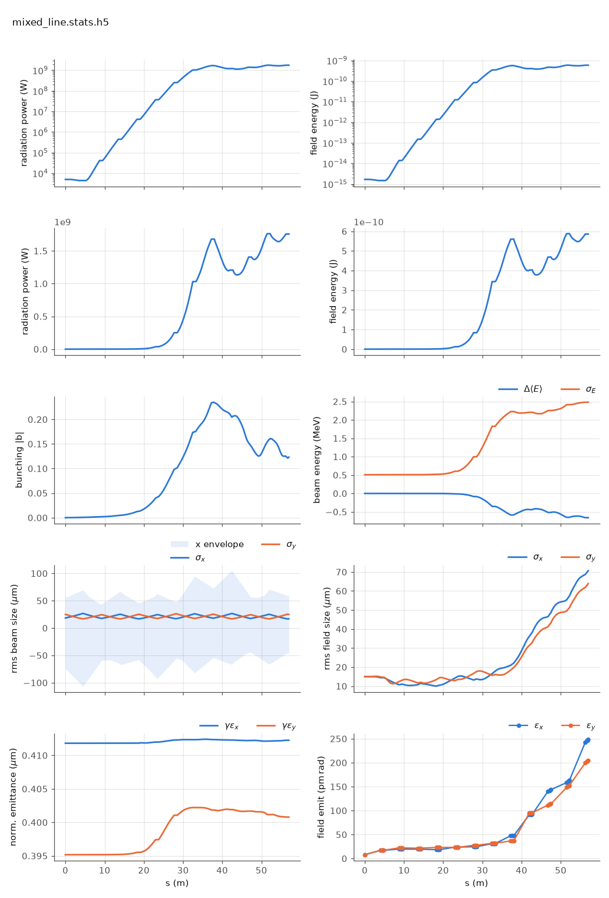

<!-- Generated by report_examples.py from examples/mixed_line/. Do not edit. -->



Everything on this page lives in and runs from `lucifer/examples/mixed_line/`.

The example runs in two commands, with Bmad only:

    ../../../production/bin/lucifer lucifer.in
    ../../../production/bin/lucifer lucifer_averaged.in
    python ../plot_fel.py mixed_line.stats.h5

The FEL method is an element attribute, so a line whose segments are tracked differently is a line of elements that differ. `mixed.bmad` calls `../aramis.bmad` for its parameters, defines `UNDU` as the same undulator carrying `fel_method = unaveraged`, and puts one `UNDU` in the third FODO cell. Eleven segments run the averaged default and the fifth runs unaveraged, integrating the real helical field with no period averaging (the manual's [unaveraged-mode section](../../fel-physics.md)).

`lucifer_averaged.in` is the all-averaged twin, which overrides that one element back to the default. The two runs differ in one segment's method and in nothing else.

On this input, a seeded steady state measured on a 129-point grid where the decks now state 128 points, the two runs give:

| | value |
|---|---|
| first difference between the runs | z = 19.045 m, the first record inside `UNDU` |
| largest difference along the line | 2.68e-2 in ln P, at z = 24.7 m |
| difference at the exit | -7.39e-3 in ln P (1.757 GW against 1.770 GW) |

In the plot the log-power panel runs straight through the boundary at 19 to 23 m, with no step and no kink where the method changes, and saturation arrives at 37 m as it does on the all-averaged line. A 2.7% difference is not visible on a six-decade axis, which is why the table above is the check and the plot is the sanity check.

The two curves are bit-identical up to the method boundary, which is the check that the mixing itself is what differs. Through the unaveraged segment they separate by 2.7%, and by the exit they have converged back to 0.74%. Two formulations of the same physics, sharing no approximation, hand the same beam and field back and forth across an element boundary.

The cost is where the difference is spent. The one unaveraged segment takes about 5 s of the 6 s run at 20 substeps per period, and the eleven averaged segments share the rest. Per-element selection puts the expensive method in the segment where it is wanted and the cheap one everywhere else.

Collective effects are refused in a line with any unaveraged segment, so this example carries none, and the harness checks the refusal.

The harness runs the same configuration as its sandwich check. There the mixed line must agree with the all-averaged line at the exit, the energy ledger rows must appear only inside the unaveraged segment, and a wake on that segment must be refused ([validation](../../validation.md)). This directory is the runnable version of that check.

The run reports the split between the mode and the wide-angle emission of the point beamlets. That emission comes from macroparticles that occupy one grid point each, and no real beam radiates it ([SASE convergence](../../startup-noise.md)). At the exit the power outside the split angle is 3.0 times the power inside it in both runs, so three quarters of each exit power is that emission. The difference between the two runs is 3.6e-2 in ln P inside the mode against 7.4e-3 in the total, so the price the mixed line pays is five times larger in the mode than in the number the table quotes. Both decks state `global%source_filter = F`, so the two FEL methods compare like for like. The filter reaches the averaged elements only and would filter eleven segments of one line and twelve of the other.

The run takes ~7 s, and the averaged twin ~1 s.

## Measured on this run

The runner wrote these from each run's stats file and log, and the keystone regenerates them. A float carries five significant digits.

| Quantity | `lucifer.in` | `lucifer_averaged.in` | Unit |
|---|---|---|---|
| exit power | 1.6598e+09 | 1.6863e+09 | W |
| exit power per slice | 1.6598e+09 | 1.6863e+09 | W |
| exit pulse energy | 5.5366e-10 | 5.6247e-10 | J |
| peak power | 1.6722e+09 | 1.6863e+09 | W |
| s of the peak power | 3.8000e+01 | 5.7000e+01 | m |
| mode peak, power inside the split | 1.1880e+09 | 1.1814e+09 | W |
| s of the mode peak | 3.8000e+01 | 3.8000e+01 | m |
| exit power inside the split | 3.8097e+08 | 3.8720e+08 | W |
| exit power outside the split | 1.2789e+09 | 1.2991e+09 | W |
| outside over inside, the run's maximum | 4.0755e-01 | 4.1176e-01 |  |
| outside over inside at the exit | 3.3569e+00 | 3.3550e+00 |  |
| split angle | 2.9077e-06 | 2.9077e-06 | rad |
| gain length, the shortest e-folding length over five consecutive records | 1.8661e+00 | 1.8661e+00 | m |
| power at the first element end | 4.4159e+03 | 4.4159e+03 | W |
| power per slice at the first element end | 4.4159e+03 | 4.4159e+03 | W |
| exit bunching, mean |b| over slices | 1.1891e-01 | 1.1251e-01 |  |
| bunching, the run's maximum | 2.3538e-01 | 2.3527e-01 |  |
| slice energy spread at the start | 5.0869e+05 | 5.0869e+05 | eV |
| slice energy spread at the exit | 2.4231e+06 | 2.4181e+06 | eV |
| slices | 1 | 1 |  |
| records | 1105 | 1105 |  |
| slice spacing | 1.0000e-10 | 1.0000e-10 | m |
| macroparticles per slice | 2048 | 2048 |  |
| grid points | 128 | 128 |  |
| grid cell | 3.1500e-06 | 3.1500e-06 | m |
| grid derived by setup | no | no |  |
| FEL steps | 6319 | 1068 |  |

## The input files

The deck, its variants, and any lattice they name, as they are on disk.

### `lucifer.in`

```fortran
&fel_params
  lat_file = "mixed.bmad"
  global%out_root = "mixed_line"
  global%source_filter = F   ! The averaged and unaveraged twins compare like for like.
/

&fel_beam_init
  beam_init%n_particle = 2048
  beam_init%bunch_charge = 1.000692285594e-15
  beam_init%sig_z = 0
  beam_init%sig_pz = 8.804506566858e-5
  beam_init%a_norm_emit = 4e-7
  beam_init%b_norm_emit = 4e-7
/

&fel_wavefront_init
  wavefront_init%lambda0 = 1e-10
  wavefront_init%seed_power = 5e3
  wavefront_init%seed_waist_size = 30e-6
  wavefront_init%grid_n_pts = 128
  wavefront_init%grid_half_width = 2e-4
/
```

### `lucifer_averaged.in`

```fortran
&fel_params
  lat_file = "mixed_averaged.bmad"
  global%out_root = "mixed_averaged"
  global%source_filter = F   ! The averaged and unaveraged twins compare like for like.
/

&fel_beam_init
  beam_init%n_particle = 2048
  beam_init%bunch_charge = 1.000692285594e-15
  beam_init%sig_z = 0
  beam_init%sig_pz = 8.804506566858e-5
  beam_init%a_norm_emit = 4e-7
  beam_init%b_norm_emit = 4e-7
/

&fel_wavefront_init
  wavefront_init%lambda0 = 1e-10
  wavefront_init%seed_power = 5e3
  wavefront_init%seed_waist_size = 30e-6
  wavefront_init%grid_n_pts = 128
  wavefront_init%grid_half_width = 2e-4
/
```

### `mixed.bmad`

```fortran
! The benchmark line with one segment tracked unaveraged and the other eleven averaged.
! The tracking method is an element attribute, so a mixed line is a line of elements
! that differ, exactly as the tapered line is (fel-physics.md sec-element).

call, file = ../aramis.bmad

UNDU: UND, fel_method = unaveraged

CELL:  line = (UND,  D1, QF, D2, UND, D1, QD, D2)
CELLU: line = (UNDU, D1, QF, D2, UND, D1, QD, D2)
MIXED: line = (2*CELL, CELLU, 3*CELL)

use, MIXED
```

### `mixed_averaged.bmad`

```fortran
! The all-averaged twin of mixed.bmad: the one unaveraged segment overridden back to
! the default, so the two runs differ in that segment's method and nothing else.

call, file = mixed.bmad

UNDU[FEL_METHOD] = averaged
```
