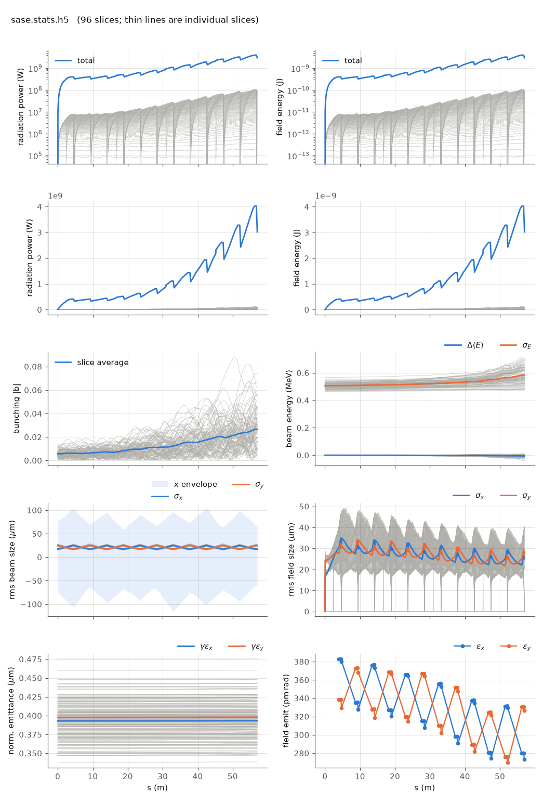

<!-- Generated by report_examples.py from examples/sase/. Do not edit. -->



Everything on this page lives in and runs from `lucifer/examples/sase/`.

The example runs in one command, with Bmad only:

    ../../../production/bin/lucifer lucifer.in
    python ../plot_fel.py sase.stats.h5

This is self-amplified spontaneous emission from nothing but the electrons. The loader generates a 96-slice time window at a spacing of 3 wavelengths, imposes physical shot noise by weighted Fawley loading, and starts the field dark (`seed_power = 0`). The FEL then grows through the full line with slippage active. Before imposing the noise the loader prints the per-slice electron count `N_lambda`, the effective count `N_eff`, and the quiet floor it verified. The noise level is therefore a reported number.

The exit power of a run like this one is set by the transverse cell size and the macroparticle count as much as by the physics, since each beamlet radiates into every angle the grid carries. The SASE convergence page measures that and says how to choose the grid, the window and the load. `global%source_filter = T` suppresses the wide-angle part, with its edge derived from the beam and the gain and printed at setup. Every run also reports `power_inside_angle` beside the total power at each element end, so the separation is in the stats file without a dump.

The beam is a flat coasting bunch in Bmad's own vocabulary: `distribution_type(3) = "GRID"` over the window extent. The current is derived as `I = Q*c/extent`, so `bunch_charge` encodes 3 kA exactly.

On this input (`ran_seed` at its 12345 default) the startup power settles near 0.06 MW per slice after the first segment. The total reaches 34.0 MW at z = 57 m with a per-slice spread of 1.3, which is the SASE fluctuation, and the induced energy spread grows from 0.99 to 1.01 m_e c^2. With the source filter off the same deck reports 4 MW per slice at startup and 3.0 GW at the exit, of which 96 percent is the wide-angle emission of the point beamlets. What the filter removes here is a factor of ninety in the reported power ([the convergence section](../../fel-physics.md#sec-convergence)).

Two features of the plot are physics and not artifacts. The total-power sawtooth is radiation slipping out of the head of a finite time window at each drift while fresh vacuum enters at the tail. Genesis 1.3 Version 4 (Genesis4) shows the same sawtooth, as does any finite window. Deep saturation of every slice needs a window longer than the total slippage. The per-slice lines in the power panel are the slippage cascade itself.

`global%keep_escaped_field = T` banks what slips out and reconstructs the whole pulse at the exit. It is off here for two reasons. On this configuration the bank and the reconstructed pulse come to 1.2 GB and 1.3 GB. And those two files are the one place the tracker still writes Genesis4 field conventions rather than openPMD ([reading an output file](../../reading-output.md)).

The run reports the split between the mode and the wide-angle emission of the point beamlets. That emission comes from macroparticles that occupy one grid point each, and no real beam radiates it ([SASE convergence](../../startup-noise.md)). The filter is on by default and this deck runs with it. At the exit the power outside the split angle of 3.0 µrad is 1.9 percent of the power inside it, so the 34.0 MW above is the mode. With the filter off the same deck reports 3.0 GW at a ratio of 24, 96 percent of it that emission. Four times the macroparticles is not enough on this window, since 8192 per slice still gives 920 MW at a ratio of 12. Leaving the grid out of the deck derives 128 points over 192 µm instead of the 256 over 200 µm here, and that grid gives 31.6 MW at 0.013. Two grids a factor of two apart in cell size therefore agree to 7 percent once the artifact is gone.

The run takes ~25 s.

## The input files

The deck, its variants, and any lattice they name, as they are on disk.

### `lucifer.in`

```fortran
&fel_params
  lat_file = "../aramis.bmad"
  global%out_root = "sase"
  slicing%window_length = 2.88e-8
  slicing%n_wavelength = 3
/

&fel_beam_init
  beam_init%n_particle = 2048
  beam_init%bunch_charge = 2.881993782512e-13
  beam_init%distribution_type(3) = "GRID"
  beam_init%grid(3)%x_min = -1.44e-8
  beam_init%grid(3)%x_max =  1.44e-8
  beam_init%sig_pz = 8.804506566858e-5
  beam_init%a_norm_emit = 4e-7
  beam_init%b_norm_emit = 4e-7
  shot_noise = T
/

&fel_wavefront_init
  wavefront_init%lambda0 = 1e-10

  wavefront_init%seed_power = 0
  wavefront_init%grid_n_pts = 256
  wavefront_init%grid_half_width = 2e-4

/
```
