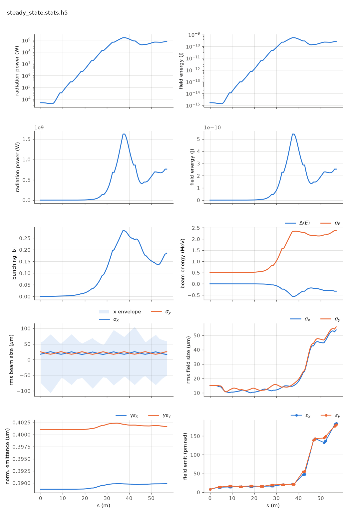

<!-- Generated by report_examples.py from examples/steady_state/. Do not edit. -->



Everything on this page lives in and runs from `lucifer/examples/steady_state/`.

The example runs in one command, with Bmad only:

    ../../../production/bin/lucifer lucifer.in
    python ../plot_fel.py steady_state.stats.h5

This is a seeded, single-slice FEL on the benchmark line (`../aramis.bmad`): a 3 kA slice and a 5 kW Gaussian seed at its waist are tracked through 6 FODO cells of helical undulator. Nothing external is read. The program generates the quiet-start beam and the seed field from the namelist, and the lattice supplies everything else.

`sig_z = 0` makes the run steady state. The whole charge sits in the one slice window, so the current is `I = Q*c/slice_spacing`, and `bunch_charge` in the deck encodes 3 kA exactly. The current is always derived this way and never entered ([the input reference](../../input-reference.md)).

On this input the quiet start is exact to an initial bunching of 4.0e-17, so the FEL grows from the seed and not from sampling noise. The power gain length is 2.25 m, fitted to ln P over 4 to 30 m of lattice, which includes the gainless breaks between segments. Saturation reaches 1.56 GW at z = 37.2 m. Past saturation the power falls back to 792.7 MW at the exit as particles rotate in the bucket. The beam sizes start on the lattice's matched values, since `init_beam_distribution` generates the bunch from the Twiss in the lattice's `beginning` statement.

The two `dump_*_at` lines write the beam and the field at the third undulator, `steady_state-at9-UND.beam.h5` and `-at9-UND.wf.h5`, both openPMD. `at9` is the element index the locator resolved. Mid-run dumps are how a run is handed to another program or restarted from the middle, and a single slice keeps them under 1.5 MB here. The same two lines on a 96-slice run write 111 MB.

Read [reading an output file](../../reading-output.md) for the stats file and the ten plot panels. The run reports the split between the mode and the wide-angle emission of the point beamlets. That emission comes from macroparticles that occupy one grid point each, and no real beam radiates it ([SASE convergence](../../startup-noise.md)). At saturation the power outside the split angle is 0.08 percent of the power inside it, and at the exit 0.24 percent, so the 792.7 MW quoted above is the mode. With the filter off the same deck reported 761.5 MW at the exit and 1.62 GW at saturation, of which 45 and 9 percent were that emission.

The run takes ~5 s.

## Measured on this run

The runner wrote these from each run's stats file and log, and the keystone regenerates them. A float carries five significant digits.

| Quantity | `lucifer.in` | Unit |
|---|---|---|
| exit power | 8.0199e+08 | W |
| exit power per slice | 8.0199e+08 | W |
| exit pulse energy | 2.6752e-10 | J |
| peak power | 1.5611e+09 | W |
| s of the peak power | 3.8134e+01 | m |
| mode peak, power inside the split | 1.5578e+09 | W |
| s of the mode peak | 3.8000e+01 | m |
| exit power inside the split | 7.9951e+08 | W |
| exit power outside the split | 2.4843e+06 | W |
| outside over inside, the run's maximum | 1.3742e-03 |  |
| outside over inside at the exit | 3.1073e-03 |  |
| split angle | 2.9661e-06 | rad |
| gain length, the shortest e-folding length over five consecutive records | 2.1043e+00 | m |
| power at the first element end | 4.1639e+03 | W |
| power per slice at the first element end | 4.1639e+03 | W |
| exit bunching, mean |b| over slices | 2.4127e-01 |  |
| bunching, the run's maximum | 3.0142e-01 |  |
| slice energy spread at the start | 5.0879e+05 | eV |
| slice energy spread at the exit | 2.5464e+06 | eV |
| slices | 1 |  |
| records | 1105 |  |
| slice spacing | 1.0000e-10 | m |
| macroparticles per slice | 8192 |  |
| grid points | 256 |  |
| grid cell | 1.5690e-06 | m |
| grid derived by setup | no |  |
| FEL steps | 1068 |  |
| source filter, mode angle | 2.9660e-06 | rad |
| source filter, rho angle | 2.6110e-06 | rad |
| source filter, ratio of the angles | 1.1400e+00 |  |
| source filter, edge | 2.9661e-06 | rad |

## The input files

The deck, its variants, and any lattice they name, as they are on disk.

### `lucifer.in`

```fortran
&fel_params
  lat_file = "../aramis.bmad"
  global%out_root = "steady_state"
  global%dump_beam_at = "UND##3"
  global%dump_field_at = "UND##3"
/

&fel_beam_init
  beam_init%n_particle = 8192
  beam_init%bunch_charge = 1.000692285594e-15
  beam_init%sig_z = 0
  beam_init%sig_pz = 8.804506566858e-5
  beam_init%a_norm_emit = 4e-7
  beam_init%b_norm_emit = 4e-7
/

&fel_wavefront_init
  wavefront_init%lambda0 = 1e-10

  wavefront_init%seed_power = 5e3
  wavefront_init%seed_waist_size = 30e-6
  wavefront_init%grid_n_pts = 256
  wavefront_init%grid_half_width = 2e-4
/
```
