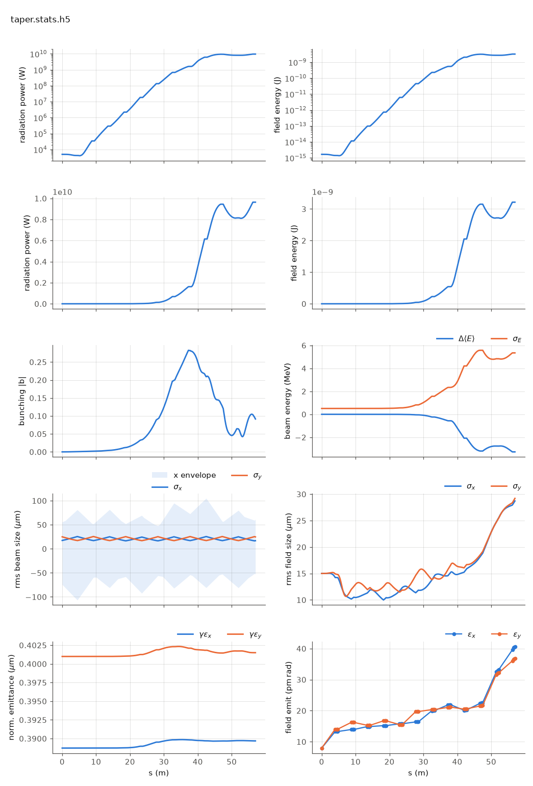

<!-- Generated by report_examples.py from examples/taper/. Do not edit. -->



Everything on this page lives in and runs from `lucifer/examples/taper/`.

The example runs in one command, with Bmad only:

    ../../../production/bin/lucifer lucifer.in
    python ../plot_fel.py taper.stats.h5

This is the `steady_state` run over `taper.bmad`. That lattice is `../aramis.bmad` for the first four FODO cells, and the last two cells use a second undulator definition, `UND2`, whose `b_max`, and so `aw`, is 0.4% lower. A step-down taper re-matches the resonance to the beam the FEL has already decelerated, so the power keeps climbing past the point where the untapered line saturates and turns over.

The FEL parameters are lattice attributes, so a heterogeneous line is a line of elements that differ. Each element carries its own `b_max`, `l_period` and `field_calc`, and the tracker derives each segment's `aw` from the element it is standing in. There is no per-segment namelist input and nothing to keep in step with the lattice.

Against `../steady_state` with the same seed and the same starting state, the untapered `../aramis.bmad` saturates and then falls back, and `taper.bmad` is still climbing at the exit. The exit power and the peak power of each line are in the table below on its example's page. On the tapered line the peak sits at the exit.

The step is at z = 38.0 m, where the fourth FODO cell ends. The two gain curves are bit-identical until the first record inside the first `UND2`, at z = 38.045 m. That is the check that the two runs differ in the taper and in nothing else. The exit power is an order of magnitude above the untapered exit and several times the untapered saturation peak.

The run reports the split between the mode and the wide-angle emission of the point beamlets. That emission comes from macroparticles that occupy one grid point each, and no real beam radiates it ([SASE convergence](../../startup-noise.md)). The table gives the power outside the split angle over the power inside it at the exit. On the tapered line it is well under a percent, so the exit power is the mode and the taper's gain is the mode's. With the filter off the same deck reports more power, the excess being that emission.

The run takes about four seconds.

## Measured on this run

The runner wrote these from each run's stats file and log, and the keystone regenerates them. A float carries five significant digits.

| Quantity | `lucifer.in` | Unit |
|---|---|---|
| exit power | 8.8074e+09 | W |
| exit power per slice | 8.8074e+09 | W |
| exit pulse energy | 2.9378e-09 | J |
| peak power | 8.8074e+09 | W |
| s of the peak power | 5.6760e+01 | m |
| mode peak, power inside the split | 8.7969e+09 | W |
| s of the mode peak | 5.7000e+01 | m |
| exit power inside the split | 8.7969e+09 | W |
| exit power outside the split | 1.0530e+07 | W |
| outside over inside, the run's maximum | 1.1970e-03 |  |
| outside over inside at the exit | 1.1970e-03 |  |
| split angle | 2.9661e-06 | rad |
| gain length, the shortest e-folding length over five consecutive records | 2.1043e+00 | m |
| power at the first element end | 4.1639e+03 | W |
| power per slice at the first element end | 4.1639e+03 | W |
| initial bunching, mean |b| over slices | 3.9886e-17 |  |
| exit bunching, mean |b| over slices | 6.0533e-02 |  |
| exit bunching, the largest slice | 6.0533e-02 |  |
| bunching, the maximum along the line of the mean |b| | 3.0278e-01 |  |
| s of the bunching maximum | 3.8403e+01 | m |
| bunching at the mode peak | 6.0533e-02 |  |
| power of the largest slice at the bunching maximum | 1.6909e+09 | W |
| exit power of the largest slice | 8.8074e+09 | W |
| mean slice energy at the start | 5.8038e+09 | eV |
| mean slice energy at the exit | 5.8009e+09 | eV |
| mean slice energy, exit minus start | -2.9349e+06 | eV |
| slice energy spread at the start | 5.0879e+05 | eV |
| slice energy spread at the exit | 5.2387e+06 | eV |
| span of the slice energies at the exit, head to tail | 0.0000e+00 | eV |
| slices | 1 |  |
| records | 1105 |  |
| slice spacing | 1.0000e-10 | m |
| macroparticles per slice | 8192 |  |
| grid points | 256 |  |
| grid cell | 1.5690e-06 | m |
| grid derived by setup | no |  |
| FEL steps | 1068 |  |
| source filter, mode angle | 2.9660e-06 | rad |
| source filter, rho angle | 2.6110e-06 | rad |
| source filter, ratio of the angles | 1.1400e+00 |  |
| source filter, edge | 2.9661e-06 | rad |

## The input files

The deck, its variants, and any lattice they name, as they are on disk.

### `lucifer.in`

```fortran
&fel_params
  lat_file = "taper.bmad"
  global%out_root = "taper"
/

&fel_beam_init
  beam_init%n_particle = 8192
  beam_init%bunch_charge = 1.000692285594e-15
  beam_init%sig_z = 0
  beam_init%sig_pz = 8.804506566858e-5
  beam_init%a_norm_emit = 4e-7
  beam_init%b_norm_emit = 4e-7
/

&fel_wavefront_init
  wavefront_init%lambda0 = 1e-10

  wavefront_init%seed_power = 5e3
  wavefront_init%seed_waist_size = 30e-6
  wavefront_init%grid_n_pts = 256
  wavefront_init%grid_half_width = 2e-4
/
```

### `taper.bmad`

```fortran
! Two-stage tapered variant of ../aramis.bmad: the same 6-FODO-cell line, with the last
! two cells' undulators a second element definition whose b_max is stepped down 0.4%.
! What the taper does to the gain curve is this directory's README.

no_digested
parameter[geometry] = open
parameter[particle] = electron
parameter[e_tot] = 11357.82 * m_electron

beginning[beta_a] = 8.53711
beginning[alpha_a] = -0.703306
beginning[beta_b] = 17.3899
beginning[alpha_b] = 1.40348

! Stage 1: aw = 0.84853 rms helical, the Benchmark1-SASE undulator.
UND1: wiggler, l = 3.99, l_period = 0.015, field_calc = helical_model, &
      b_max = 0.84853 * (twopi / 0.015) * m_electron / c_light, &
      fel_method = averaged, ds_step = 0.045

! Stage 2: the same device with b_max, and so aw, 0.4% lower.
UND2: UND1, b_max = 0.99600 * 0.84853 * (twopi / 0.015) * m_electron / c_light

D1: drift, l = 0.44
D2: drift, l = 0.24
QF: quadrupole, l = 0.08, k1 = 2.0
QD: quadrupole, l = 0.08, k1 = -2.0

FODO1: line = (UND1, D1, QF, D2, UND1, D1, QD, D2)
FODO2: line = (UND2, D1, QF, D2, UND2, D1, QD, D2)
TAPERED: line = (4*FODO1, 2*FODO2)

use, TAPERED
```
